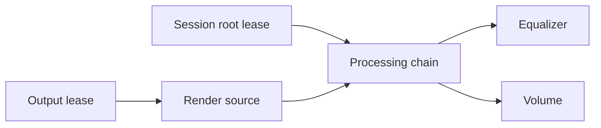

# Typed lifetime graph

`Lease<T>` is a non-null shared ownership node. `make` owns a leaf; `dependent` creates a new object from an owning factory and leases of its existing dependencies. The factory receives references to those inputs, and the new node retains their owners until after its own object is destroyed. Dependencies are established at construction and are not rewired through this API. This makes construction order describe a directed acyclic lifetime graph.

Leases cannot be default/null constructed or created from a borrowed pointer/shared-pointer alias. Copies are non-throwing and remain valid even when copied from rvalues. Represent absence with `optional<Lease<T>>`. `member<&T::field>()` retains the parent when observing a direct data member and preserves constness; member functions cannot manufacture unowned reference views. Direct access requires a named lvalue lease. `WeakLease::lock()` obtains a real ownership lease before exposing an object.

Factories return unique ownership. Concrete deleters are preserved through interface views; dependencies are released after the dependent object, including during exceptional construction. Factories still own the correctness of references they capture from outside the declared graph. Object access and mutable state require their own synchronization. Graph construction, ownership changes and last-owner destruction belong outside real-time callbacks; rendering uses prebound references backed by retained nodes.

`LeaseHandle<T>` transfers a move-only capability while retaining its owner. Derived ports supply exclusive claim/release policy. Moving empties the source; `retain_owner()` keeps an active call valid through reentrant handle disposal. Clearing publishes the inert state before retiring ownership.

Include `<wiola/foundation/lease.hpp>` / `<wiola/foundation/lease_handle.hpp>` and link `wiola::lifetime`. Configure `-DWIOLA_COMPONENTS=lifetime -DENABLE_UNIT_TESTS=OFF` to build and run the standard-only consumer without SDK or GoogleTest downloads. Implementation, contracts and ordinary consumer tests stay in this owner.

`OwnerThreadLifetime<T>` covers externally owned objects, such as a window service that may disappear during a notification. Its copyable `Observation` retains only an invalidation sentinel, never the owner. Observations can travel through workers, but `get()` and `invalidate()` run on the original owner thread; Debug assertions catch violations. A returned pointer is a short borrow: recheck the observation after a reentrant call. The owner explicitly invalidates at its teardown boundary; the lifetime member's destructor is a fallback. The scope cannot move or copy. Scan publication and metadata writing use this same protocol instead of private pointer-state structs.

| Relationship | Representation |
| --- | --- |
| Small independent immutable policy | Store a value |
| Independently retained object/dependency | `Lease<T>`; construct dependency edges with `dependent` |
| Cross-thread observation requiring an ownership pin | `WeakLease<T>::lock()` |
| Externally owned object observed on its owner thread | `OwnerThreadLifetime<T>::Observation` |
| Internal reference within a nonmoving, structurally owned aggregate | A direct reference or borrowed handle, with enforced teardown order |

Owner-thread observation does not synchronize target state or protect a pointer across concurrent destruction. Use a real lease when the target must survive an operation on another thread. Include `<wiola/foundation/owner_thread_lifetime.hpp>` from the same `wiola::lifetime` component.

`PreparedChange<Owner, Candidate>` retains an owner lease, a candidate and a nonthrowing apply operation. Bind it to a `ChangeVersion` data member of that owner. Preparing or discarding does not advance the version; a successful commit makes older candidates stale. Version identity uses preallocated stamps rather than a wrapping counter. Commit performs no allocation and rejects repeated or reentrant commits. Active state survives disposal of the outer transaction during apply; candidate/callable destruction precedes owner release. Operations are serialized on the owner control thread, outside render callbacks.

Include `<wiola/foundation/prepared_change.hpp>`. Readiness can be composed with candidate-specific validation before committing a larger transaction. `candidate()` is a borrowed const view for that preflight; it does not transfer ownership. Empty apply operations and null version members are rejected during setup, and failed setup does not invalidate existing candidates.
