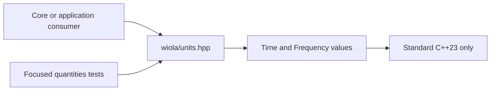

# Frequency and time quantities

This component owns the existing `wiola::units` values, dimensional constraints, arithmetic, comparisons, chrono conversions and literals. Time, Frequency and their related unit tags stay together because conversions and consumers form one coherent contract. No class-per-directory or namespace migration is introduced.

Link `wiola::quantities` and include `<wiola/units.hpp>`. Public headers expose only this component and standard library types; the target exports the supported header and language requirement without the source-root umbrella, Qt, codec, device or application dependencies. Component installation is `wiola_quantities`; external consumers use `find_package(wiola_quantities CONFIG REQUIRED)`. Build and install targets have the same namespace/name.

The implementation preserves existing value semantics, reciprocal preconditions and namespaces. Reciprocal conversions require nonzero quantities; runtime assertions and compile-time constraints retain their existing behavior. Private arithmetic stays in the header's detail namespace, where templates can use it without a separate helper component.

The complete implementation is [units.hpp](units.hpp), beside its export definition and [focused tests](tests/README.md). Installation publishes that actual header as `<wiola/units.hpp>` and excludes test/build support. Root `WIOLA_COMPONENTS=quantities` configuration avoids player SDKs through [CMake component selection](../../../cmake/components.cmake).
