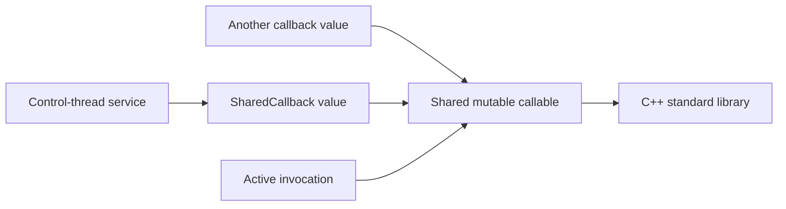

# Shared callback

`wiola::core::SharedCallback<Signature>` is an optional callable with shared identity. Copies observe the same mutable target. Reassigning one value changes only that value; existing copies and active calls retain the previous target. Each call retains that target before invoking it, so a callback can replace or destroy its containing object without destroying the active callable's captures. Empty invocation throws `std::bad_function_call`. Targets use the ordinary copyable-callable requirements of `std::function`; arguments and return values may be move-only.



Include `<wiola/foundation/shared_callback.hpp>` and link `wiola::shared_callback`. The header-only component has no player or Qt dependency. Workspace scan publication and metadata write notification use it; their private lifetime checks still protect service continuations after a callback returns. The abstraction owns the callable, not objects captured by reference, and does not serialize calls or synchronize mutable captures. It is intended for control/notification code, not real-time audio processing.

Configure/build/test the standard-only consumer without SDK or GoogleTest downloads:

```bash
cmake -S . -B build-callback -DWIOLA_COMPONENTS=shared_callback -DENABLE_UNIT_TESTS=OFF
cmake --build build-callback
ctest --test-dir build-callback --output-on-failure
```

With unit tests enabled, `shared_callback_test` exercises shared state, moves, empty invocation, reentrant replacement/destruction, forwarding, exceptions and last-owner cleanup. `SharedCallback.Consumer` verifies ordinary downstream use. Complete implementation, build declaration and tests stay in this owner.
