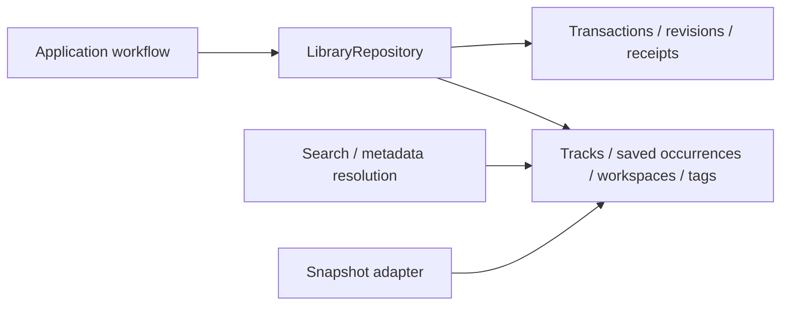

# Library catalog

This owner contains catalog identities, track/playlist/workspace records, metadata/tag rules, queries and the repository contract/implementation. MediaId identifies a catalog track; PlaylistEntryId identifies one saved occurrence. Playback QueueEntryId and provider ResourceReference have their own separate meanings.



InMemoryRepository implements the declared mutations and observations. Borrowed record pointers observe repository state; callers should not retain them across repository changes. Value snapshots and projected rows own the facts they retain. Metadata patches distinguish inherit, set and clear; saved duplicates keep separate occurrence identities.

`relocation.hpp/cpp` matches supplied fingerprints and reconciles observed locations without opening files. Native byte reading and persisted digest encoding belong to the [local media adapter](../media/local/README.md). Historical native path-to-ID conversion belongs to [application local-import policy](../app/library/local_identity.hpp); catalog identities themselves are opaque. `preferred_location` observes stored record order without probing files. Qt JSON/storage is implemented by the [Qt storage adapter](../qt/storage/README.md). Focused catalog cases live in [tests](tests/README.md), with workflow cases under [application tests](../app/tests/README.md). No Qt types are used by this source owner.

Workspace mutations store supplied roots with lexical normalization only; they do not consult the process current directory. Native folder-opening and restore adapters resolve relative roots before committing catalog changes, including historical stored roots.

Transactions have an editing phase, a frozen commit phase and a finished phase. The persistence callback can observe the candidate but cannot mutate it or recursively commit it. A failed or throwing commit restores records, identity allocators and staged-delta state immediately. Uncommitted scope exit performs the same nonthrowing cleanup; successful commits remain published even when an observer throws. Explicit rollback after commit failure is unnecessary; the public lifecycle is construction, edits and commit.

`resolve_title` owns title-layer and filename-fallback policy. Complete metadata resolution and normalized search extraction share it; search does not clone unrelated comments/composer fields or stored tag identities.

## Standalone catalog SDK

Select `WIOLA_COMPONENTS=library` to configure the catalog and its media/quantity dependencies without preparing Qt, codecs, playback or a device backend. `ENABLE_UNIT_TESTS=OFF` omits the test framework. The source tree stays flat; CMake exposes supported build/install headers under `<wiola/library/...>`.

```sh
cmake -S . -B build-library -DWIOLA_COMPONENTS=library -DENABLE_UNIT_TESTS=OFF
cmake --build build-library
cmake --install build-library --prefix "$PWD/build-library/sdk"
```

Consumers use `find_package(wiola_library CONFIG REQUIRED)` and link `wiola::library`. The target supplies C++23, media value types and its thread dependency, without the legacy source-root umbrella. The installed-package test relocates the prefix, compiles each public header independently and exercises catalog transactions, duplicate occurrences, querying and durability receipts. Native file/provider and Qt headers remain outside that package.

Durability receipts belong to the accepting thread. A failed attempt retains its observers for retry; success is terminal. Cancellation suppresses remaining and future callbacks. Delivery isolates observer exceptions, finishes all eligible callbacks, then rethrows the first failure. An observer that completes a revision reentrantly prevents stale failure delivery to the remaining callbacks. `CommitResult` records the original acceptance state; later durability is observed through its receipt.
