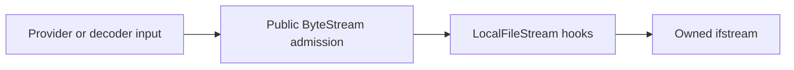

# Local-file byte adapter

LocalFileStream implements the public media ByteStream hooks with an owned native `ifstream`. Link `wiola_local_file_stream`; format identification, tags and decoding belong to its consumers, not this adapter.

The static open operation checks context and regular-file access before returning ownership. Construction is private, so callers receive a successfully opened object. Public byte operations perform common cancellation/deadline and count admission; the file hooks own native ranges, stream flags, cursor movement and I/O failures. Destruction closes the handle after its owning consumer releases it.

Real file integration cases are in `tests/media`; portable byte-contract cases stay with `core/media`. The adapter has no Qt, device or codec SDK dependency. Its current checkout include convention is `<media/local_file_stream.hpp>`.
