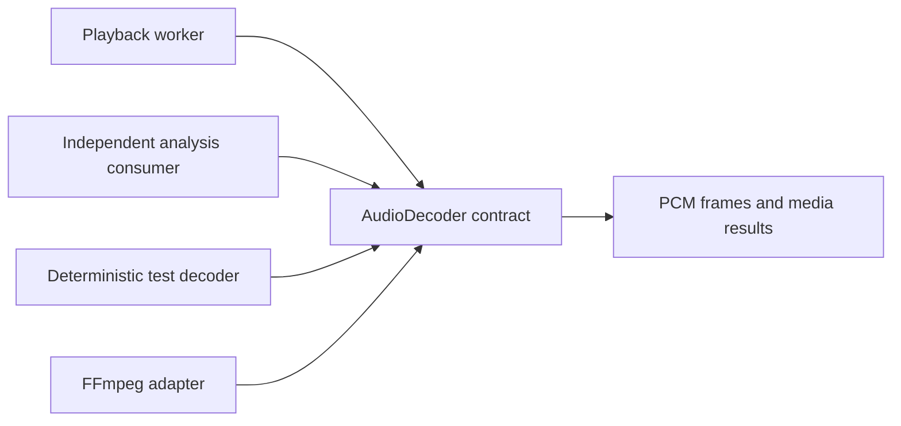

# Audio decoder contract

This folder owns `wiola::media::AudioDecoder`, its stream/progress/seek values, `DecoderOpenResult` and the shared read/seek validation implemented in `audio_decoder.cpp`. Link `wiola::audio_decoder` and include `<media/audio_decoder/audio_decoder.hpp>`. A consumer sees PCM frames and media results; it has no codec registry, format parser, FFmpeg packet, resampler, device or GUI dependency.

To implement a backend, derive from `AudioDecoder`, provide stream information, and implement `decode` and `seek_frame`. The shared implementation owns output-frame alignment, exact-length bounds, decoded position, explicit exhaustion and typed failure propagation. Backend code owns source I/O and format details. A short read is progress rather than implicit EOF; a successful read must advance or report EOF. Estimated/unknown lengths do not clamp reads. Failed seeks do not change the contract's position. The backend must make its seek transactional and report the achieved position.

The caller owns the decoder and serializes its blocking read/seek operations on a worker. This interface does not schedule threads, execute on a device callback or select a backend. Stream information is immutable after construction. Destroying the owning pointer destroys the backend; no registry or media asset lifetime is borrowed by this contract.

The complete implementation, target, [focused media-port test](tests/README.md) and guide are colocated. Build `media_audio_decoder_contract_test` for deterministic read/seek behavior and `media_audio_decoder_port_test` for media-asset ownership. Both link without the codec registry or FFmpeg. `codec_audio_decoder_test` retains the real-format integration case; its original semantic test name is unchanged. Neutral contract tests live here and share no production driver. New feature consumers depend on this target; format/backend selection belongs at application composition, not here.

Portable PCM/result declarations still use the legacy `wiola_core` include export; restricting that broad export is separate public-dependency work. The historical owner ID remains stable for coverage lineage. The old codec declaration, implementation and `Decoder` alias are removed, so there is one canonical interface. Decoder creation uses `Result<std::unique_ptr<AudioDecoder>>` through the same API: success transfers ownership and failure carries the shared media error. The former alias-only opening header is consolidated here, rather than becoming a separate folder or target.
