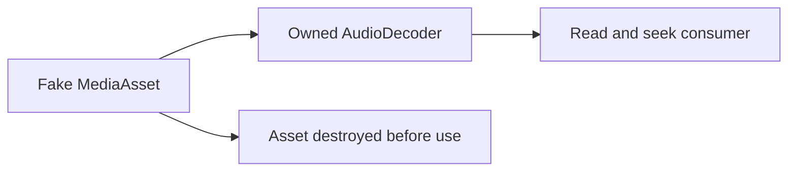

# Decoder port isolation test

`decoder_contract_test.cpp` exercises deterministic read/seek alignment, progress, lengths, exhaustion and error behavior using controlled decoders. It imports no registry or native SDK.

`decoder_port_test.cpp` constructs a fake media asset that returns an owned decoder, destroys the asset, then reads and seeks through the neutral interface. Its target links only the decoder contract, GoogleTest and build instrumentation. No codec registry, FFmpeg, output device, file fixture or GUI service is available through that target.

This is a dependency and ownership boundary test. The former mixed codec test now retains only real-backend integration; all existing neutral contract cases moved here with their semantic names intact. Keep this target independent of concrete adapters so an accidental outward dependency is visible in its configured dependency graph.
