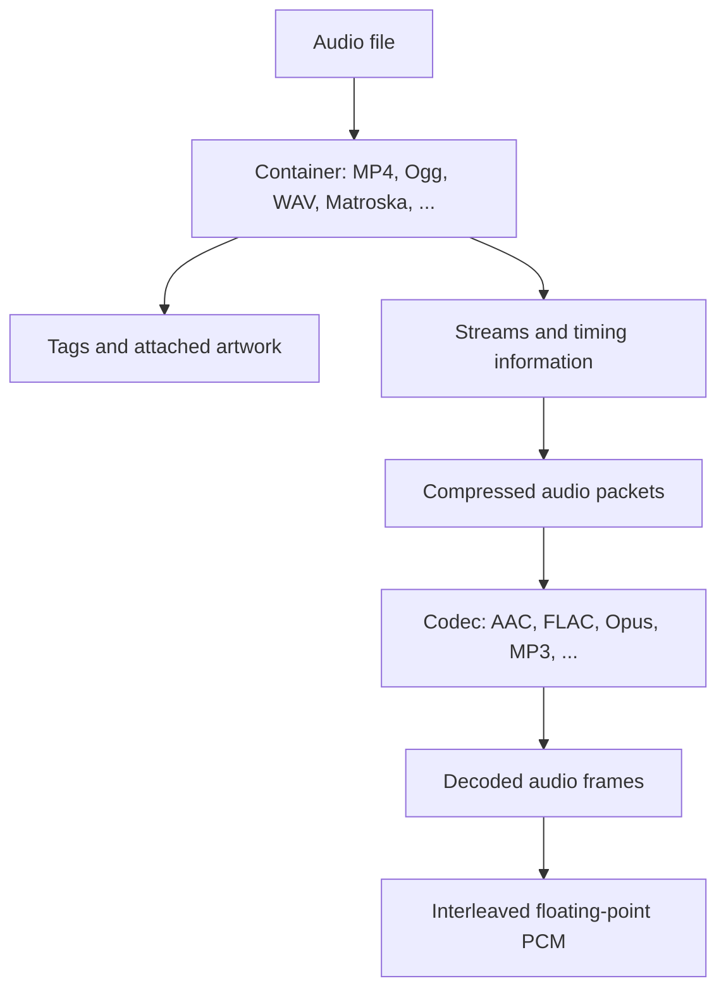
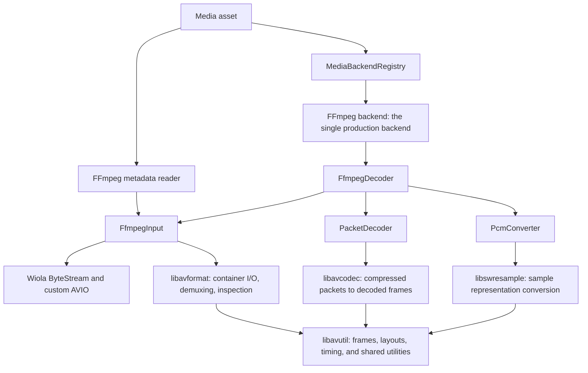
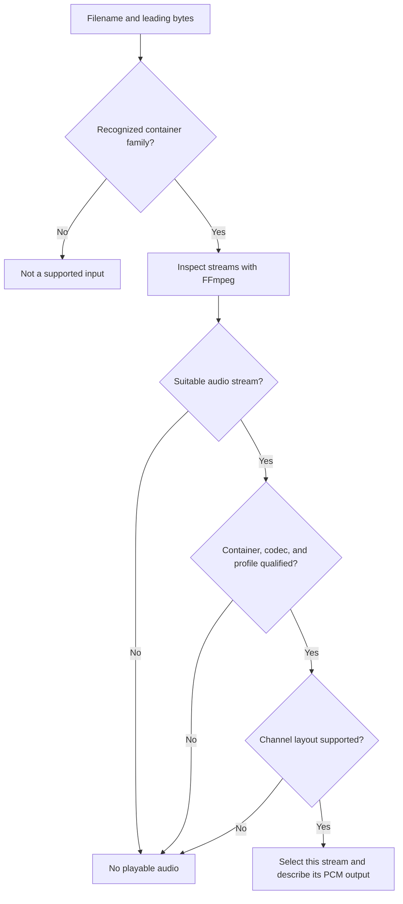
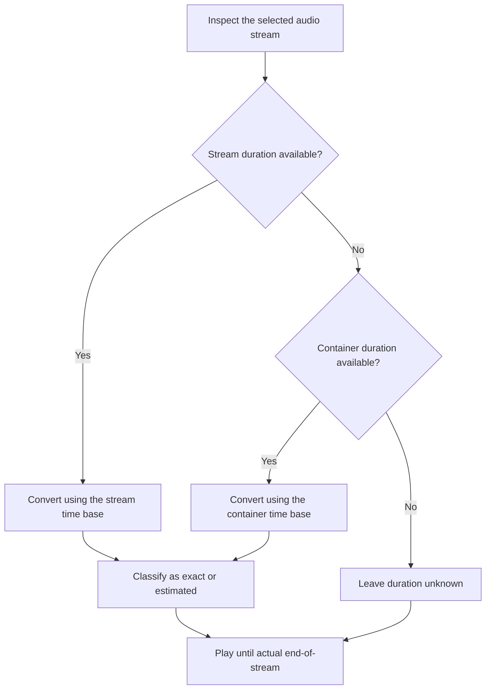
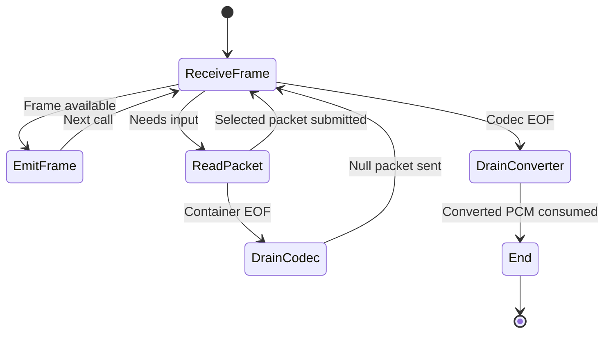
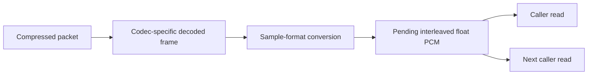
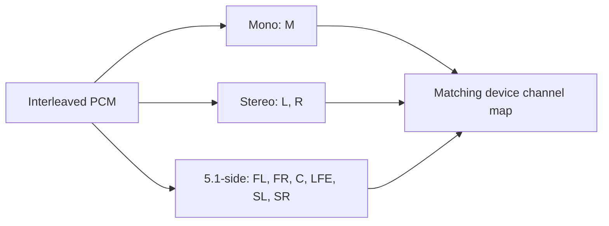
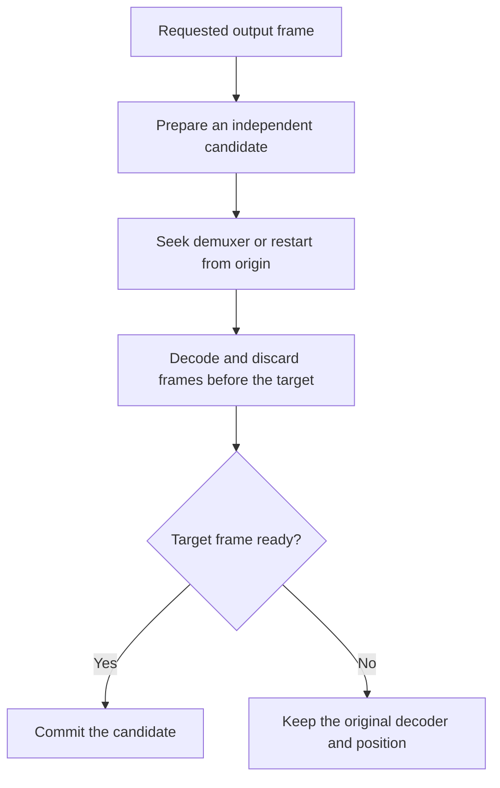
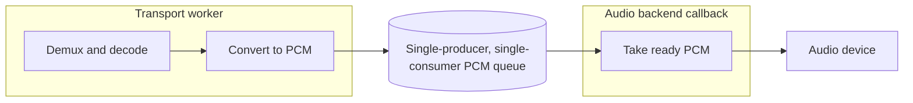
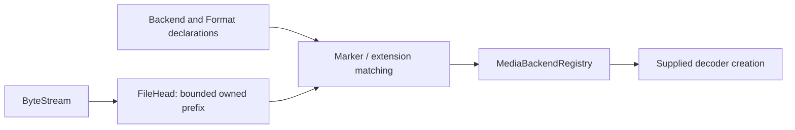

# From an audio file to sound: a codec developer's guide

This guide follows one song through Wiola's codec layer. It starts with the difference between a
container and a codec, then explains metadata, duration, packet decoding, PCM conversion, timestamps,
and seeking. The code links are optional places to explore after the ideas make sense.

FFmpeg reads containers and compressed audio. Wiola chooses what to admit, owns the decoding state,
and turns the result into interleaved floating-point PCM. Miniaudio appears only at the end, when
that PCM is sent to the audio device.

## 1. A container is not a codec

An audio file usually combines two different things:

- a **container**, such as MP4, Ogg, WAV, or Matroska, which stores streams, packets, tags, and
  timing information;
- a **codec**, such as AAC, FLAC, Opus, or MP3, which defines how audio samples are compressed into
  those packets.

A demuxer reads the container and produces compressed packets. A decoder reads packets for one
codec and produces decoded audio frames. Only after that do we have samples that can become PCM for
the audio device.



This is why “FFmpeg supports the file extension” is not enough. Wiola must support the particular
container, codec, profile, and channel layout inside it. For example, the qualification policy admits
AAC-LC in MP4 or ADTS, not every AAC profile. The exact admission set is deliberately small and is
listed in [`qualification.cpp`](ffmpeg/qualification.cpp).

### Wiola has one production backend: FFmpeg

FFmpeg is not one of several decoding backends today; it is **the only one**. The registry still
provides a neutral opening point, but its default production catalog leads to the FFmpeg backend.
The useful boundary is therefore not “a plugin system with many implementations.” It is a way to
keep FFmpeg's C objects, error codes, and ownership rules out of the engine and to allow simple fake
decoders in tests.



Each playback decoder owns its own `FfmpegInput`, `PacketDecoder`, and `PcmConverter`; the diagram
shows responsibilities, not shared global objects. The metadata reader uses a separate `FfmpegInput`.
In this way, one FFmpeg backend can still support independent metadata visits, playback cursors, and
seek candidates without sharing mutable FFmpeg state.

## 2. From a filename to an admitted audio stream

Opening a path creates a [`media::MediaAsset`](../provider.hpp). An asset represents something
that can be inspected or decoded; it is not a playback cursor. Metadata reads and decoders created
from the same asset remain independent.

Admission then answers a series of increasingly specific questions:



Content markers are stronger evidence than a suffix. FFmpeg inspection then discovers what is
actually inside. If multiple audio streams are usable, the container's default stream is preferred.
An attached picture is never selected as audio.

Wiola currently supports mono, stereo, and an explicit 5.1-side layout. It does not silently downmix
an unfamiliar surround layout to stereo. Opus is presented at its required 48 kHz output rate;
other codecs use the inspected stream rate.

The selected stream and its output description are assembled in
[`FfmpegInput::inspect`](ffmpeg/input.cpp). The input uses a Wiola-owned
[`media::ByteStream`](../byte_stream.hpp), so reads, seeks, file-size queries, cancellation,
and secondary-resource rejection do not depend on FFmpeg opening the path by itself.

## 3. Metadata is a separate visit to the container

Reading metadata does not start a playback decoder. The
[`read_metadata`](ffmpeg/metadata.cpp) function creates an independent input, selects the
audio stream, reads what it needs, and closes that input.

Title, artist, and album come from container tags first, with the selected stream's tags as a
fallback. Missing fields stay empty. Attached artwork is copied in its original encoded form; the
codec does not decode the image. Text and artwork have size limits so hostile metadata cannot create
unbounded allocations.

Because this visit has its own file cursor, it cannot rewind a song that is already playing.

## 4. Duration comes from timing information, not necessarily from tags

A duration is often derived by the demuxer rather than written as an ordinary tag. Wiola tries the
selected stream first and the container second:



A time base explains the units. A duration of `441000` with a time base of `1/44100` means ten
seconds. At 44,100 Hz, that becomes 441,000 PCM frames.

Depending on the format, FFmpeg may use sample tables, indexes, packet timestamps, bitrate, or file
size to produce its answer. Wiola does not add a second bitrate-based estimate of its own. If
neither source is usable and non-negative, duration remains unknown.

Wiola does **not** decode the whole song to count its frames. However, `avformat_find_stream_info`
may read packets or briefly invoke a decoder while establishing stream facts. The input has a
256 KiB probe size and a one-second analysis-duration limit. The precise guarantee is therefore “no
full-track decode,” not “compressed audio is never touched.”

### Why the accuracy of a length matters

Container time and audible sample count are not always identical. Encoder delay and padding can add
samples before or after the music. Wiola therefore distinguishes:

- **exact** lengths, which may bound output;
- **estimated** lengths, which are useful for display but never truncate audio;
- **unknown** lengths, which provide no output boundary.

Supported PCM and sample-count-based lossless formats use exact lengths when available. MP4 AAC is
also exact when the stream itself supplies a duration. Other reported durations remain estimates.
Actual end-of-stream always has the final say, so an estimate cannot cut off the end of a song.

## 5. Demuxing and decoding are a two-way pump

FFmpeg's packet decoder is not simply “read one packet, get one frame.” A packet may produce no
frame immediately, several frames may be waiting inside the codec, and delayed frames may appear
only after input has ended.

[`PacketDecoder::next_frame`](ffmpeg/packet_decoder.cpp) therefore asks for a decoded frame
first. If FFmpeg needs more input, the loop reads another packet. Packets belonging to other streams
are discarded. If a packet is accepted, the loop asks for frames again.



Container EOF is not necessarily audible EOF. When no more packets exist, Wiola submits a null
packet to drain the codec. After the codec is drained, the PCM converter is drained too. Only when
all converted samples have been consumed does the public decoder report end-of-stream.

This is why a final read can contain both audio and the end-of-stream flag. A short read means
progress, not necessarily the end.

## 6. Decoded frames are not yet the engine's PCM

Different codecs produce different sample representations: signed or unsigned integers, floating
point, packed samples, or separate planes per channel. Wiola standardizes them into interleaved
32-bit floating-point PCM.

[`PcmConverter`](ffmpeg/pcm_converter.cpp) configures itself from the first decoded frame.
It preserves the promised sample rate and channel layout while converting the sample representation.
Later frames must keep the same rate, channel count, sample format, and layout. A stream that changes
shape mid-flight is rejected instead of corrupting the playback queue's assumptions.

The converter also holds pending output. Codec frames and caller read sizes do not have to match:
one decoded frame can supply several reads, and a small read does not force the rest of the frame
to be thrown away.



For 5.1-side audio, the semantic side-speaker order is preserved. There is no hidden downmix. For
mono and stereo, the default FFmpeg layout is sufficient.

### What mono, stereo, and 5.1-side look like in PCM

A **sample** is one number for one channel. A **PCM frame** is the group of samples, one per
channel, captured at the same instant. The sample rate counts frames per second, not individual
floating-point values per second.

Mono stores one float per frame:

```text
frame 0    frame 1    frame 2
  M0         M1         M2
```

Stereo stores left and right together, two floats per frame:

```text
frame 0       frame 1       frame 2
 L0  R0        L1  R1        L2  R2
```

Wiola's 5.1-side layout stores six floats per frame in this exact order:

```text
frame 0
 FL0  FR0  C0  LFE0  SL0  SR0

frame 1
 FL1  FR1  C1  LFE1  SL1  SR1
```

`FL` and `FR` are front left/right, `C` is center, `LFE` is the low-frequency effects channel, and
`SL` and `SR` are **side** left/right. The `.1` names the LFE channel; it does not mean a fraction
of a sample. Side speakers are not interchangeable with rear speakers, which is why Wiola names
this layout `five_point_one_side` instead of treating any six-channel stream as identical.

For frame `i`, the channel at `channel_index` lives at:

```text
buffer[i * num_channels + channel_index]
```

Thus stereo frame 10 starts at float index 20, while a 5.1-side frame 10 starts at index 60. This
is also why queue operations must preserve frame alignment: shifting a stereo buffer by one float
would swap left and right, and shifting a 5.1 buffer would reinterpret every speaker position.



The converter changes sample representation, not the channels' meanings. The device layer then maps
the same positions to Miniaudio. Mono uses `MA_CHANNEL_MONO`; stereo uses front left/right; 5.1-side
uses front left/right, center, LFE, and side left/right. There is no downmix in this path.

The [PCM guide](../README.md) develops the sampling theory, buffer indexing, memory sizes, and
frame-aligned queue rules in more detail.

## 7. Timestamps describe audible positions

A compressed packet timestamp is not automatically the sample position the listener expects. Stream
start offsets, codec delay, and decoded-frame timing all matter.

Wiola uses each decoded frame's best-effort timestamp, rescales it to the output sample rate, and
subtracts the stream's encoded origin. The first audible timestamp establishes an origin for normal
playback. When timestamps move backwards at a container link, Wiola rebases them at the current
output position instead of moving the public cursor backwards.

Equal-shape chained inputs can continue this way. A rate, channel-count, sample-format, or semantic
layout change is rejected rather than allowing differently shaped PCM into the same queue.

Exact lengths can trim final padding. Estimated and unknown lengths never clamp output, because a
plausible container estimate is not permission to remove audible frames.

## 8. Seeking requires decoding, not just a file seek

Moving a compressed file cursor to a nearby packet is only the beginning. The requested audible
sample may depend on earlier packets, and the first decoded frames may be preroll rather than sound
the listener requested.

Wiola therefore prepares an independent candidate decoder on the transport worker. It positions the
candidate, decodes toward the target, discards preroll, and waits until the requested frame is ready.
Only then does the candidate replace the current input state.



MP3 needs special care because demuxer seeking does not provide a reliable sample-accurate audible
timeline. Wiola may restart from the origin and count decoded frames sequentially. Other streams
can also restart from the origin when a demux seek fails or lands beyond the requested sample.

The candidate is another decoder state, not another thread. A failed seek leaves the current
position usable.

## 9. Where codec work runs

The codec does not need a general thread pool. Its synchronous operations are called by a small
number of owners around it:

- one loader worker can inspect and construct the next decoder;
- one metadata worker can read playlist tags;
- one transport worker can demux, decode, convert, and seek the current decoder;
- the audio callback consumes PCM but never calls FFmpeg.

The current decoder can therefore keep playing while the loader opens the next one and the metadata
worker reads another file. Each activity has independent input and decoder state.



FFmpeg's codec is configured with `thread_count = 1`, so decoding uses the transport thread that
made the call. Seek candidates do not add a thread. The queue keeps blocking codec work away from
the real-time audio callback.

## 10. Errors and cancellation stay inside a neutral contract

Containers and codecs are exposed to damaged and hostile files. Wiola bounds probing, metadata,
artwork, packet work, conversion work, frame sizes, and seek preroll. Failures become
[`media::Result`](../result.hpp) values with stable categories rather than leaking FFmpeg error
codes into the engine.

An [`OperationContext`](../operation_context.hpp) carries cooperative cancellation and an
optional deadline. Input callbacks and decode/seek loops observe it. This stops unnecessary opens
and long operations without trying to kill a thread inside third-party code.

## 11. A useful source-reading order

Follow the codec in the same order as the data:

1. [`provider.cpp`](../local/provider.cpp) — assets, inspection, metadata, and decoder creation.
2. [`input.cpp`](ffmpeg/input.cpp) — custom I/O, stream selection, and duration.
3. [`qualification.cpp`](ffmpeg/qualification.cpp) — the exact container/codec/profile
   admission set.
4. [`packet_decoder.cpp`](ffmpeg/packet_decoder.cpp) — packet submission, frame reception,
   and codec draining.
5. [`pcm_converter.cpp`](ffmpeg/pcm_converter.cpp) — sample conversion, pending PCM, and
   converter draining.
6. [`decoder.cpp`](ffmpeg/decoder.cpp) — timestamps, output length policy, chaining, and
   transactional seeking.

That path takes you from container bytes to the final audible sample without requiring a detour
through the rest of the application's thread management.


## Codec recognition and registration

This owner contains bounded leading-byte recognition, backend/format declarations and registry selection. Concrete container/codec work stays under the backend owner; byte access uses the public media port.



FileHead propagates read failure separately from an empty prefix. A marker's offset must lie within retained bytes, then its length must fit the remaining range before any span is formed. This subtraction-based check cannot wrap an offset-plus-length sum. Empty marker ranges match only valid positions, including the retained end; descriptor qualification owns any stronger signature policy.

Signature tests use owned in-memory bytes, independent of native files. They cover ordinary offsets, short input, high byte values, empty/end ranges and maximal offsets that previously caused an ASan stack underflow. Native file admission and codec input are tested by their actual owners.
