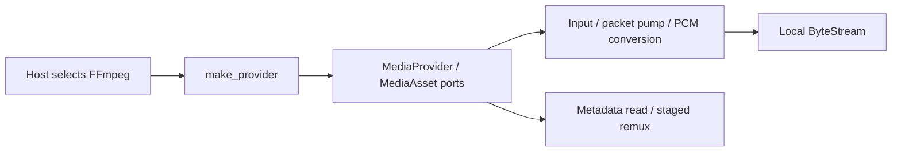

# FFmpeg adapter

`composition.hpp` exposes `make_provider()` through the portable MediaProvider interface and `make_registry()` for an explicitly selected backend set. Link `wiola_ffmpeg_provider` for the current local-file composition. Its implementation, metadata access and decoder construction live together here; the concrete provider/asset classes remain private to `provider.cpp`.

AV structures, C callbacks, tag mapping, artwork limits and writable-container decisions belong to this adapter. Portable application consumers include media contracts, rather than FFmpeg input or conversion helpers. Registry matching remains a separate format-independent policy receiving an explicit backend set.

The input closes the format context before its custom I/O context and buffer. Callback errors preserve the first stream diagnostic; exception translation never allocates. Packet decoding checks its input stream index and observes cancellation between pump operations. Seeking prepares a candidate input/decoder/converter and publishes it only after successful preroll.

[Integration tests](../tests) qualify real encoded fixtures, metadata roundtrips and decoded audio. Format-independent selection cases link `wiola_codec_decode` without FFmpeg. The supported writable-format qualification belongs to the FFmpeg metadata writer suite.
