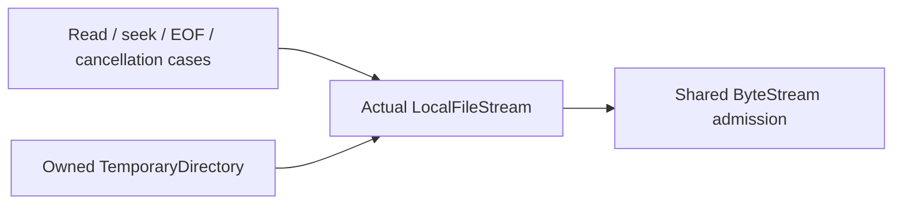

# Local-file stream contracts

`media_local_file_stream_test` links the concrete `wiola::local_media` adapter. Its scoped directory fixture owns each file and outlives the opened stream; sanitizer configurations never share a global test filename.

Cases exercise actual bytes, cursor movement, short/repeated EOF, context rejection without mutation, and missing/nonregular-file failures. Construction requires a successful open. Portable stream admission and signature parsing are tested in their own owners with controlled byte sources, without a decoder dependency here.

Rejected seeks from start/current/end target a negative absolute byte. Cases read immediately after rejection, before `tell` or another seek could clear stream flags, and verify the original tail. A separate EOF case verifies rejected movement does not turn ordinary exhaustion into a read failure. The raw report retains native I/O failure paths outside these ordinary file rejection/recovery scenarios.

`media_local_resource_test` verifies Unicode round trips without an existing file, component/separator identity, preservation of relative/alias spelling, foreign-provider rejection, embedded-null rejection and ordered batches with duplicates. These conversion cases need no codec SDK or GUI. Provider integration additionally checks rejection of a foreign reference whose key names a real fixture and cancellation/deadline priority.
