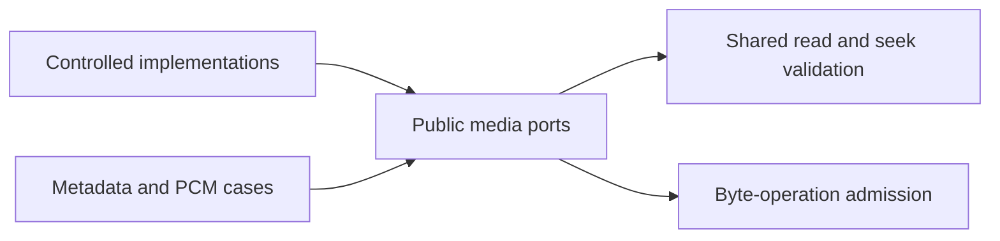

# Media contract tests

These targets link `wiola::media` directly, without the checkout-wide `wiola_core` include path. No production driver, filesystem fixture, output device or Qt service is part of their dependency closure.

`decoder_contract_test.cpp` checks alignment, exact/estimated/unknown lengths, progress, explicit EOF, transactional seeking and typed errors. `decoder_port_test.cpp` destroys an asset before using its owned decoder, then reads and seeks through the public interface.

`byte_stream_test.cpp` executes the actual nonvirtual ByteStream operations. Controlled hooks observe context/argument forwarding, cancellation and deadline rejection, empty-read no-op behavior, overreported counts and typed backend failures. Owned forward-only bytes check short EOF separately from failure. No fictional large span or file access is needed to exercise the portable boundary.

`track_metadata_test.cpp` checks independent metadata fields and emptiness. `metadata_writer_test.cpp` checks field-edit requests and the read-only asset default. `stream_spec_test.cpp` checks frame/sample/time conversion, overflow and channel-layout admission. These are relocated existing cases with unchanged semantic names and target identities.

Configure with `-DWIOLA_COMPONENTS=media` and build the local targets declared in `CMakeLists.txt`. Ordinary player builds compose these same targets. The real local-file integration cases live under `local/tests` and link the concrete file adapter directly. Signature tests consume the shared byte fixture rather than writing globally named temporary files.

`Media.Consumer` is an ordinary executable built from `consumer.cpp` and linked to `wiola::media`. It exercises the public contracts using supplied collaborators; CTest runs the configured executable directly.

`media_resource_test` verifies owned reference values, provider-qualified identity, stable ordering/grouping when labels differ, and namespace separation for equal keys. Nonthrowing moves preserve the playback installation commit guarantee.
