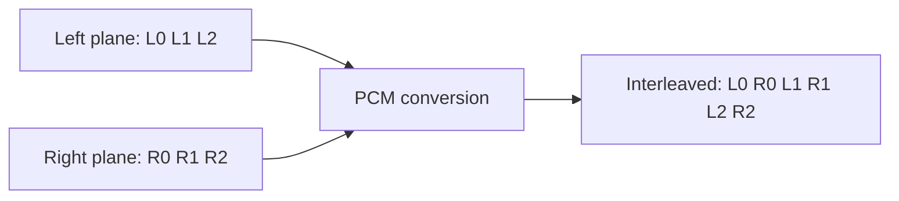

# PCM in Wiola: samples, frames, and channel layouts

Pulse-code modulation, or PCM, represents a waveform as a sequence of numeric amplitude
measurements. This guide starts with that theory and then shows exactly how Wiola stores mono,
stereo, and 5.1-side audio in memory.

The two central types are [`StreamSpec`](../core/media/public/wiola/media/stream_spec.hpp), which describes the stream, and
[`PcmQueue`](pcm_queue.hpp), which moves complete frames from the decoder thread to the audio
callback.

## 1. From a waveform to numbers

An analog waveform changes continuously over time. To represent it digitally, we measure its
amplitude at regular intervals. Each measurement is a **sample**, and the number of measurements
per second for each channel is the **sample rate**.

At 48,000 Hz, one channel is measured 48,000 times per second. The time between adjacent frames is:

```text
1 / 48000 second = approximately 20.83 microseconds
```

A higher sample rate represents faster amplitude changes but requires more samples for the same
duration. The sample rate does not describe loudness, and it does not change when more channels are
added.

PCM samples can use different numeric representations. Integer PCM encodes amplitude in a fixed
numeric range; floating-point PCM stores amplitude as a floating-point value. Wiola converts every
supported codec to **32-bit floating-point samples** for processing and output. This gives the DSP
code one consistent representation regardless of whether the source was integer PCM, FLAC, AAC, or
another codec.

The source file's byte order and packed encoding no longer matter at this stage. Wiola's playback
buffers are in-memory native C++ `float` values, not bytes that should be written directly to a WAV
file.

## 2. A sample is not a frame

The distinction matters whenever audio has more than one channel:

- a **sample** is one number for one channel;
- a **frame** contains one sample for every channel at the same instant;
- the **sample rate** counts frames per second, not floats per second.

For a stream with `num_channels` channels:

```text
sample count = frame count * num_channels
frame count  = sample count / num_channels
duration     = frame count / sample rate
```

Wiola reinforces this distinction with the [`Frames`](../core/media/public/wiola/media/stream_spec.hpp) type. Plain `std::size_t`
values and spans count individual samples; `Frames` counts complete channel groups. Arithmetic that
could overflow or start with an invalid stream has checked conversion functions in `StreamSpec`.

### Memory required

Wiola uses four bytes per float, so:

```text
bytes = frames * channels * 4
```

One second at 48,000 Hz requires:

| Layout | Frames | Float samples | In-memory size |
| --- | ---: | ---: | ---: |
| Mono | 48,000 | 48,000 | 192,000 bytes |
| Stereo | 48,000 | 96,000 | 384,000 bytes |
| 5.1-side | 48,000 | 288,000 | 1,152,000 bytes |

All three streams have the same one-second duration. Only the channel count changes their memory
and bandwidth requirements.

## 3. Interleaved and planar PCM

**Planar** storage keeps a separate array for each channel. A stereo stream might look like:

```text
left:  [ L0, L1, L2, L3 ]
right: [ R0, R1, R2, R3 ]
```

Many codecs naturally decode into planar buffers because each channel can be processed separately.

**Interleaved** storage places channels together frame by frame:

```text
[ L0, R0, L1, R1, L2, R2, L3, R3 ]
```

This is Wiola's playback representation because the processing chain and audio callback consume one
continuous buffer.



Conversion changes the representation, not the sound or the channel meanings.

## 4. Mono: one sample per frame

Mono has a single channel and one float per frame:

```text
frame 0    frame 1    frame 2
  M0         M1         M2
```

Its buffer indexing is straightforward:

```text
sample for frame i = buffer[i]
```

Two consecutive mono frames contain two floats and occupy eight bytes.

Wiola maps the mono channel to `MA_CHANNEL_MONO` in
[`Device::set_channel_map`](../audio/device/device.cpp). There is no artificial duplication into a
stereo buffer inside the codec.

## 5. Stereo: two samples per frame

Stereo has left and right channels. They alternate in memory, with left first:

```text
frame 0       frame 1       frame 2
 L0  R0        L1  R1        L2  R2
```

The general indexing rule is:

```text
left sample for frame i  = buffer[2 * i]
right sample for frame i = buffer[2 * i + 1]
```

For example, this buffer contains three complete stereo frames:

```text
float samples: [ 0.1, -0.1,  0.2, -0.2,  0.3, -0.3 ]
                 L0   R0     L1   R1     L2   R2
```

It contains six floats but only three frames. At 48,000 Hz, those three frames last 3 / 48,000 of a
second, not 6 / 48,000.

A stereo frame occupies eight bytes. Device output maps the two positions to front left and front
right.

## 6. 5.1-side: six samples per frame

A 5.1 stream contains six channels: five full-range channels and one low-frequency effects channel.
The `.1` is the LFE channel; it does not represent a fraction of a sample or frame.

Wiola supports the **side** variant with this exact frame order:

```text
index:  0     1     2    3      4     5
        FL    FR    C    LFE    SL    SR
```

- `FL`: front left;
- `FR`: front right;
- `C`: center;
- `LFE`: low-frequency effects;
- `SL`: side left;
- `SR`: side right.

Two frames therefore occupy twelve floats:

```text
frame 0                              frame 1
 FL0 FR0 C0 LFE0 SL0 SR0              FL1 FR1 C1 LFE1 SL1 SR1
```

The channel lookup rule is:

```text
sample for frame i and channel c = buffer[6 * i + c]
```

For example, the center sample in frame 4 is `buffer[6 * 4 + 2]`, or `buffer[26]`. One complete
5.1-side frame occupies 24 bytes.

Side speakers are not interchangeable with rear speakers. Wiola calls this layout
`five_point_one_side` and configures both FFmpeg's `AV_CH_LAYOUT_5POINT1` and Miniaudio's side-left
and side-right map. Unknown six-channel arrangements are not assumed to have the same meaning.

There is no silent downmix: six input channels remain six output channels with the same semantic
order.

## 7. The rule that connects every layout

For any supported layout, the sample at a particular frame and channel is:

```text
buffer[frame_index * num_channels + channel_index]
```

`frame_index * num_channels` is the first float in the frame, and `channel_index` selects a speaker
inside it.

This explains why frame alignment is an invariant rather than an optimization. A one-float shift in
stereo swaps left and right. A one-float shift in 5.1-side changes every subsequent speaker mapping.
Even if the number of floats remains valid, the audio no longer has the intended meaning.

[`StreamSpec`](../core/media/public/wiola/media/stream_spec.hpp) records all three pieces of information needed to interpret the
buffer:

- `sample_rate`: frames per second;
- `num_channels`: floats per frame;
- `channel_layout`: what those channel positions mean.

A channel count alone is not a complete layout. Six channels could represent different speaker
assignments, which is why Wiola checks semantic layout during stream admission.

## 8. Moving frames between threads

[`PcmQueue`](pcm_queue.hpp) connects the transport worker to the audio callback. It is a
single-producer, single-consumer ring of `float` values:


The producer belongs to decoding. The consumer belongs to audio output. There must be only one of
each; this is not a general multi-producer work queue.

The queue adds channel-aware rules to the generic ring:

- producer input must contain a whole number of frames;
- available space is rounded down to a complete-frame boundary;
- a short push still ends at a frame boundary;
- a consumer span that is not frame-aligned is shortened to its complete-frame prefix;
- rounding the ring's capacity may leave trailing samples unused rather than expose a partial
  frame.

The queue reports sizes in **samples**, while its configuration accepts a minimum number of
**frames**. Keeping those units explicit prevents capacity and duration mistakes.

The approximate size and space functions describe the current ring state; they are not a locking
protocol or an exact snapshot shared by both threads.

## 9. What happens after the queue

The audio callback obtains interleaved PCM through
[`BufferSource::render`](../audio/dsp/buffer_source.cpp). The
[`ShapedSource`](../audio/dsp/shaped_source.cpp) then applies the processing chain before the device
receives the samples.

Processing does not redefine frame boundaries. Equalizer state is configured from the same stream
specification, volume applies to the samples, and final output sanitizing handles values outside
the device's acceptable range. The channel map remains the one established during codec inspection
and PCM conversion.

The complete path is:

```text
codec frames
  -> interleaved float PCM
  -> frame-aligned PcmQueue
  -> BufferSource
  -> processing chain
  -> Device channel map
  -> speakers
```

## 10. Where to verify the behavior

Start with the contracts in [`stream_spec.hpp`](../core/media/public/wiola/media/stream_spec.hpp) and
[`pcm_queue.hpp`](pcm_queue.hpp). Their tests exercise unit conversion, overflow checks, complete
frame alignment, short reads and writes, and channel-aware capacity rounding:

- [`stream_spec_test.cpp`](../../src/core/media/tests/stream_spec_test.cpp)
- [`pcm_queue_test.cpp`](../../tests/pcm/pcm_queue_test.cpp)

For the ends of the path, continue with
[`PcmConverter`](../codec/backends/ffmpeg/pcm_converter.cpp), which creates the interleaved float
representation, and [`Device`](../audio/device/device.cpp), which maps it to the output channels.
