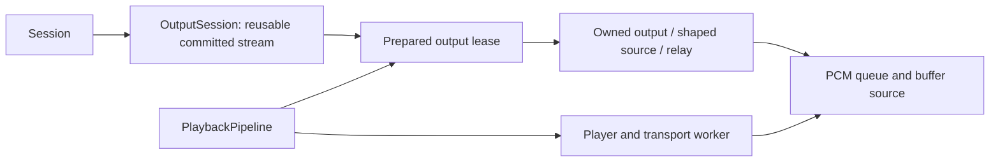

# Playback resource lifetime

This directory owns the per-track decoder/queue/transport bundle and reusable output streams. Session selects what to load and activates a prepared bundle; output construction and the complete processing Stage stay supplied by the host. Built-in equalizer/volume composition belongs to the application PlaybackService and its control facade, outside the playback kernel. The processing Stage is borrowed and must outlive the cache and all leases.

`OutputSession::prepare` constructs a stopped output or pins the matching committed stream. Failure or discarding a candidate changes neither cache nor source attachment. `activate` retains its stream and attaches the borrowed source only after old callbacks have quiesced. A lease has stable identity even when its owning unique pointer moves; its destructor detaches only if it still owns the stream's attachment. A superseded or unconnected candidate cannot detach a successor, including one using the same source address.

The cache and leases share stream ownership. A pipeline's lease pins the device and render bridge even if the cache changes format or is destroyed. Stream members destroy the output before its borrowed shaped source and relay. The bridge accepts the Stage port and does not require the built-in ProcessingChain topology. This shared ownership is local to output lifetime, not a general service registry.

PlaybackPipeline declares queue, decoded source, output lease and Player in that order. Reverse destruction joins/quiesces transport first, releases the decoder and device claim, detaches the source and releases the output pin, then frees source/queue storage. Player delegates shutdown to its owned TransportWorker rather than repeating stop/join. Setup-thread claim acquisition permits a candidate to be constructed before the prior track releases the same device.

A lease returned by this cache is activated through the same cache. Source shape must match the prepared stream. The private installation caller owns these preconditions and callback quiescence. Session prepares stage configuration, output lease, queue/player and owned resource before retiring current playback. Its last fallible step appends the completion on the single control thread; the following stop, processing commit, attachment and ownership/path swaps cannot allocate or fail. The completion becomes observable after that control turn returns. Preparation failure preserves active playback without rewinding its source. Output construction failures become typed setup errors; allocation failure retains its exceptional policy. A later device start is a separate transport operation, whose failure leaves the installed track faulted rather than classifying media as damaged.

The private relay/shaped-source helpers live with playback buffering. The output cache reads the relay's immutable stream spec rather than retaining a second copy. Pipeline/Session production targets depend only on public render ports and private playback mechanisms; tests or the application explicitly declare any built-in DSP composition they supply.
