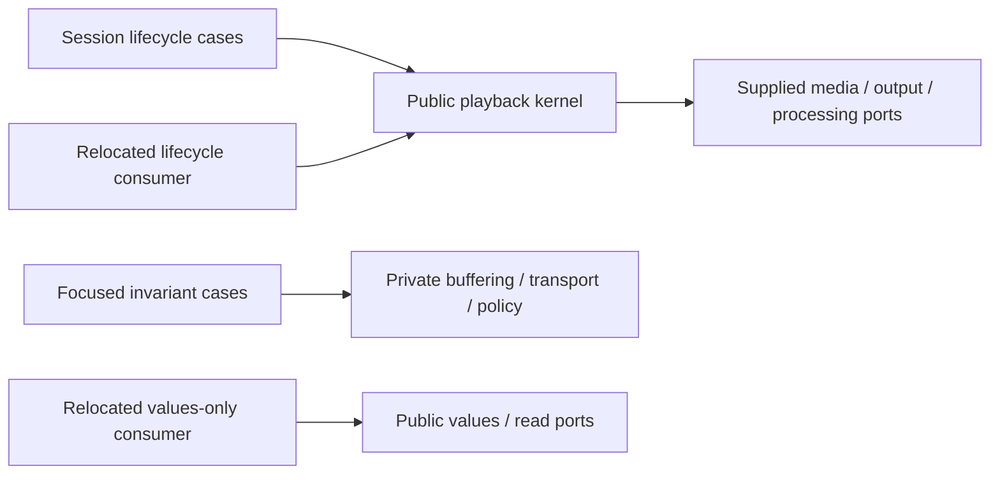

# Playback contract and lifecycle tests

These cases belong to the playback component and link actual scoped targets. Kernel tests use controlled C++ media/render ports without a codec, device or GUI SDK. Real encoded decoder-to-transport/Session journeys remain under codec integration.

`engine_session_test` qualifies queue/loading coordination, outcomes, cancellation, candidate rollback, play intent, media handoff and active teardown. Its media fixture stores DecoderStreamInfo values under scoped resource keys, synchronizes worker lookups and returns owned values. It creates no encoded files or format guesses and imports no codec data directory. Tests explicitly declare the built-in processing implementation where they supply it as a collaborator.

The [Session owner](session/README.md) keeps command, handoff and admission cases with their shared fixture. Its ordinary CMake target preserves case names; no case-to-file registry or separate test runner is needed.

Admission cases reject invalid decoder capabilities before preparing processing/output and preserve an already playing pipeline. A held open verifies occurrence removal cancels only the pending request and rejects its late result. Handoff commands check the latest play/pause/resume/seek intent and stop's position reset, independently of an older copied restoration ticket. Shuffle/unshuffle assertions preserve visible queue order without requiring a particular random permutation.

Handoff regressions distinguish installed resource identity from selected queue identity, including a failed replacement and media retained after removal/clear. Gates order restoration before/after unrelated candidate success, typed failure and invalid admission; no timing delay proves completion. Same-resource cancellation retains the new occurrence's zero-position intent. New selection/empty replacement revokes old tickets, repeated restoration is inert, and non-finite seek commands cannot poison request matching. Cancellation callbacks release held provider gates on teardown so a failed assertion cannot strand that collaborator.

[Pipeline cases](pipeline/README.md) exercise complete decoder/queue/player ownership, output cache/lease identity and callback quiescence. [Buffering](buffering/README.md), [transport](transport/README.md), [loading](loading/README.md), [queue](queue/README.md) and [metadata](metadata/README.md) cases own their focused contracts and failure witnesses.

`playback_contract_test` links the public values target only. It checks typed errors, ownership, occurrence identity and safe per-instance policies. Queue allocation cases fail each allocation until success rather than encoding an implementation count. A separate frontend case replaces backing storage and switches equal-revision owners through QueueView, retaining owned row facts.

`Playback.Consumer` links the values/media/quantity closure. `PlaybackRuntime.Consumer` links the complete kernel and supplies its own decoder, provider, Stage and output. It checks open completion, learned facts, actual processed PCM, pause/resume, seek, stop, clear and teardown. Both are ordinary C++ targets and CTest cases; no install, relocation or nested build is involved.

Installed clients use their producer's build configuration, including installation and execution for multi-configuration generators. The local unoptimized MinGW13 static C++23 failure is [GCC PR110572](https://gcc.gnu.org/pipermail/gcc-bugs/2024-June/868781.html); the Windows64 matrix qualifies Release, while a compiler containing the upstream fix is needed for that affected unoptimized configuration. No linker multiple-definition suppression is used.
