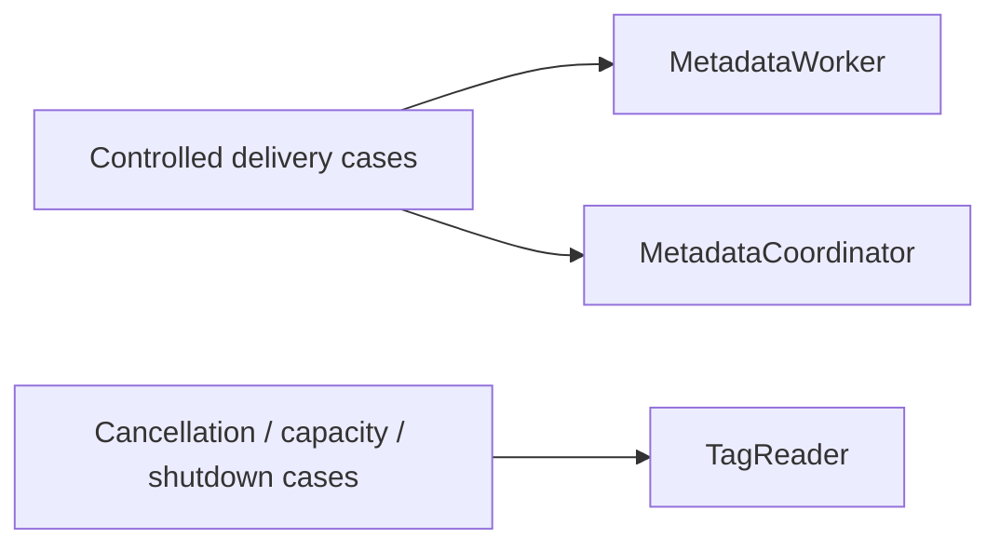

# Metadata policy and worker tests

Controlled MetadataWorker delivery tests isolate acceptance policy from scheduling: old results for the same resource, wrong occurrence/resource, duplicates and reverse completion order must not update another occurrence. Existing concrete-worker cases retain coalescing, bounded/deferred submission and typed failures.

TagReader gate cases cover synchronous cancellation callbacks querying state, newer generations surviving an older cutoff, obsolete submissions avoiding I/O, and active cancellation before join. A capacity case holds a physical older read while a newer result already fills the sole completion slot, then cancels: correctness must hold whichever side of the wait the cancellation reaches. No test assumes an elapsed delay proves that the worker entered a particular wait. Fatal allocation is checked by subprocess exit and is not represented as a recoverable metadata error.

Provider cases reject a successful null asset without losing following work, retain backend errors, and forward cancellation to an asset returned after its open was cancelled. A shutdown case holds the second read after the first fills the only completion slot; destruction must cancel and join without any collection freeing the budget. These use the shared C++ provider fake, not another backend or fixture manifest.

Configure `WIOLA_COMPONENTS=playback` to build this complete owner without Qt/FFmpeg/miniaudio. Use ordinary CTest/native sanitizers and LLVM reports; no registry, test catalog or custom scheduler is needed.
