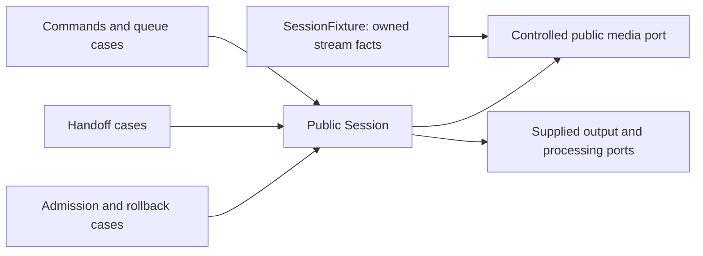

# Session contracts

This is the complete Session test owner. The ordinary `engine_session_test` executable keeps the semantic `Session.*` case names while its sources follow distinct responsibilities.

| Source | Contract |
| --- | --- |
| `commands_test.cpp` | Commands, queue observations, metadata/load completion and cancellation |
| `handoff_test.cpp` | Installed-resource identity, pending-open precedence, held intent and ticket lifetime |
| `admission_test.cpp` | Stream/buffer validation, supplied processing, output preparation and failure rollback |
| `lifecycle_model_test.cpp` | Independent command model, seeded whole-session traces, setup failure recovery and cancelled shutdown |
| `fixture.hpp` | Owned decoded-stream facts, load/poll helpers and collaborator lifetime |

SessionFixture stores explicit DecoderStreamInfo values under scoped resource keys and synchronizes worker lookups. The map, mutex and processing stage outlive Session's workers and callbacks. Assets own their paths and callback lifetimes through the shared C++ media fake. No encoded fixture files, format detection, Qt or device SDK are required. Tests that supply the built-in DSP chain declare that test dependency explicitly.

Held provider gates use cancellation callbacks where teardown must release a blocked call. State assertions use controlled completion/progress rather than assuming a sleep proves an event occurred. Admission allocation cases retain their explicit allocator/sanitizer limitations. Configure `WIOLA_COMPONENTS=playback` for this portable closure and run the target through ordinary CTest and native sanitizers.

Lifecycle traces compare the public queue, installed media, transport state and load outcomes after every settled command. Four reproducible seeds cover 384 commands with duplicate resources, format changes and unreadable candidates. A nonconsuming output makes assertions independent of EOF timing. Separate traces refuse processing/output setup, return late success after cancellation and destroy the session during blocked loading. Shared probes count decoder/output destruction and verify that stages/providers and stopped devices are released; no extra production API or test manifest is needed.
