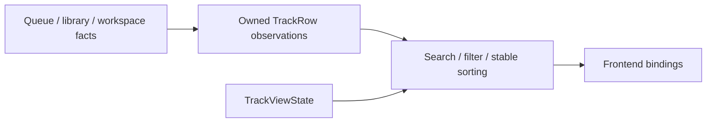

# Portable presentation

This owner contains toolkit-independent track/document observations and sorting/filtering policy. It projects queue, saved-playlist and workspace facts into owned TrackRow values, then applies the requested view state. Qt item models and event-loop delivery adapt these values in the frontend.

Link `wiola::presentation`. Related track values and algorithms live in `tracks`; document identity and source-specific row projection live in `documents`. Existing C++ names stay in `wiola::gui`; this namespace does not select a toolkit. Queue rows currently compose local path/library identity through the explicit local-resource adapter. Catalog policy and playback ownership stay with their supplied owners.

The [focused sorting tests](tests) link the actual standard C++ dependencies without Qt widgets. Their existing queue/repository fixtures supply observations to the sorting policy. The `wiola_model_boundary` consumer compiles and runs without Qt definitions; the headless configuration exercises this same target. Qt-thread delivery, QModelIndex, QVariant and widget state belong to frontend adapters.

SessionDocuments owns open/visible documents, the active destination and browser restoration values. BrowserViewState lives with the track presentation values. Queue occurrence remapping runs here without Qt, files or storage. Qt SessionState composes this portable state with window geometry, splitters and layout identity; its codec retains the existing persisted representation.

WorkspaceRows consumes the owned WorkspaceScanBatch contract from app/workspace/workspace_scan.hpp. It does not need the scanner worker, scheduling policy or native file adapter. Frontends can interpret scan results without constructing those mechanisms.
