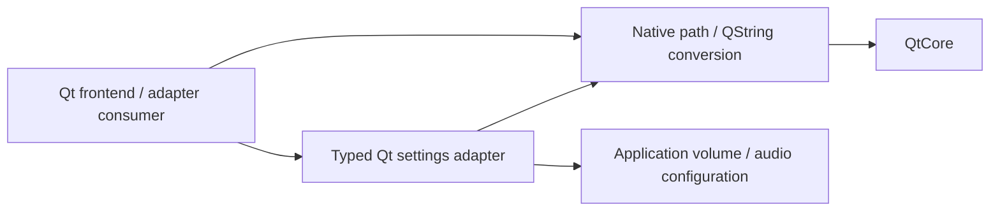

# Qt adapters

This owner contains adapters whose contract depends on Qt. Portable playback, library and presentation policy live in their respective source owners.

[paths.hpp](paths.hpp) owns native path/QString conversion. `wiola::qt_paths` is a header-only QtCore target with no player/kernel dependency. Windows conversion uses native UTF-16; other platforms preserve their existing string representation. This adapter translates native file paths, rather than interpreting arbitrary resource-provider keys.

[settings.hpp](settings.hpp) and [settings.cpp](settings.cpp) own conversion between QSettings and typed player/queue values. Defaults, legacy stored keys, gains and occurrence selection retain their existing semantics. Link `wiola_qt_settings` when using that adapter. Qt settings and GUI tests are selected only when the Qt frontend is enabled.

The [focused tests](tests) stay with these adapters. Portable code can be configured and tested with the Qt frontend disabled; the Qt-specific types do not belong to the portable playback/media interfaces.

[Storage](storage/README.md) contains independently linkable atomic file operations and library snapshot/schema storage. Keep generic file-mechanism clients independent of the catalog serializer.

[Application adapters](application/README.md), [QtCore projection](projection/README.md) and the [Widgets frontend](widgets/README.md) keep their complete implementations and tests together. Shared `queued_delivery.hpp/cpp` owns weak producer endpoints and receiver-thread delivery through `wiola::qt_delivery`. The module configures its targets in dependency order, owns the executable entry point and registers Qt tests after the production targets exist. Compatibility fixtures and shared Qt-only test support live under `tests`; portable fixtures remain outside this owner.
