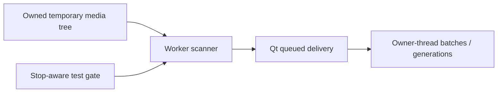

# Workspace adapter tests

These cases test Qt delivery and watching around portable workspace scanning. Worker progress is controlled by explicit stop-aware gates; bounded event-loop pumping observes owner-thread results.

Every publication case owns a scoped `TemporaryDirectory`. Publisher/worker objects are destroyed before that directory, including on failed assertions. Concurrent sanitizer builds therefore use independent files. Batching cases supply a small explicit policy and derive their data/expectations from that policy rather than duplicate production defaults.

Watcher cases use a controlled backend to check registration, refusal, coalescing and teardown independently of native watcher timing. Portable discovery/reconciliation cases stay with the [application workflow tests](../../../../app/tests/README.md).
