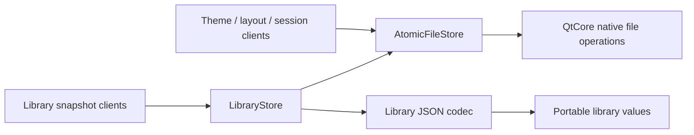

# Qt storage

This owner contains the complete QtCore storage mechanism and the library snapshot adapter built on it. Each implementation sits beside its declaration and [focused tests](tests).

`wiola::qt_files` owns AtomicFileStore and AtomicOutput. It checks byte limits, returns typed read/write errors and commits complete output atomically. Destruction discards uncommitted output. Consumers supply their own file, byte budget and optional output factory. This target has no catalog serializer dependency.

`wiola::qt_library_store` owns library JSON conversion, stored-schema validation, backup recovery and repository restoration. It depends on the generic file mechanism and portable library values. Stored versions, record validation and recovery behavior are unchanged by the source boundary. Neither target requires widgets or a codec backend.

Application persistence workflows own when a snapshot is accepted or a save is acknowledged. This driver translates and stores snapshots; it does not own playback, GUI lifetime or catalog mutation policy.
