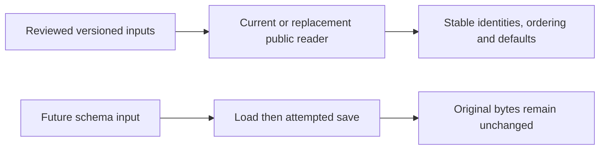

# Persisted-data compatibility corpus

This qualification suite owns independent input files and their semantic expectations. It exercises existing public library, session, settings, layout and theme APIs; it is not a second serializer implementation. The inputs were authored directly, without calling production writers.

`library_test.cpp` covers layered metadata, Unicode, missing media, repeated playlist entries, decimal 64-bit revisions, old optional defaults and transactional rejection. `session_test.cpp` protects document identity, queries, duplicate occurrences and full-width tokens. `settings_test.cpp` reads old INI values and migrates a temporary copy. `layout_test.cpp` distinguishes v1 migration from v2 identity and checks stored envelopes. `theme_test.cpp` freezes semantic color parsing and transactional rejection.

Library, session and layout future files are tested through attempted mutation and object destruction, with byte-for-byte preservation. Theme-manager persistence remains covered by the existing independently required `ThemeManager.BoundedAllowlistedImportsAndFutureFilesPreserveTheAcceptedDefinition` contract; the corpus's theme cases exercise the codec without a widget application. These are compatibility witnesses, not exhaustive coverage.

Run the `compatibility_corpus_test` target's cases. Paths come from the CMake data binding and temporary directories. The runner uses only a `QCoreApplication`; aggregate Qt Widgets linkage is current dependency debt, not a display requirement. No personal settings or audio devices are used. Reuse these inputs unchanged when replacing readers; add a new fixture for a version change rather than rewriting an old oracle to match a new writer.
