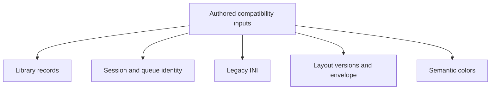

# Compatibility inputs

The child folders own schema examples for [library](library/README.md), [session](session/README.md), [settings and queue](settings/README.md), [layout](layout/README.md) and [theme](theme/README.md). `malformed.json` is intentionally truncated and must remain invalid.

Fixture changes require a compatibility reason and reviewed expectations. Future payloads include opaque fields and Unicode so preservation checks compare original bytes, not reserialized equivalents. Relative media locations are data and do not require a developer's filesystem layout. Tests only write temporary copies.
