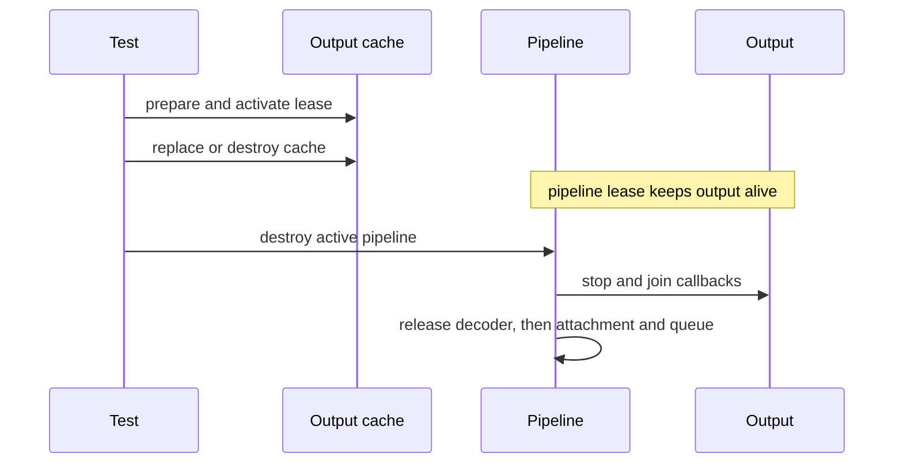

# Pipeline lifetime tests

These cases use the supplied output factory, existing FakeOutput/decoder and local ownership witnesses. They exercise output reuse, failed/null factory rollback, every preparation allocation failure, discarded candidates, attachment ownership across replacement, cache destruction and a pipeline that owns its output pin independently.

The teardown witness composes the existing controlled device rather than implementing another callback simulator. An unbounded controlled decoder keeps playback active; the test observes actual device startup before destroying the pipeline. Decoder destruction must see a live, stopped output. The output may be released only afterward. Ordinary ASan/TSan exercise worker/callback teardown through the actual bundle.

The shared allocation witness runs only where the C++ allocator replacements are available; normal lifecycle cases remain enabled under TSan. No timing sleeps, device SDK or per-test manifest is needed. Use target `engine_pipeline_ownership_test` through ordinary CTest.
