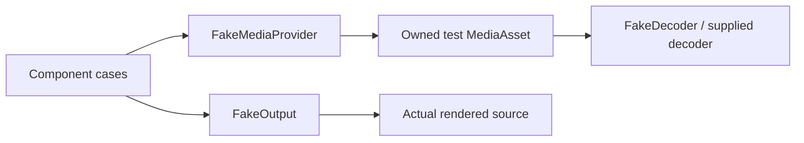

# Controlled playback collaborators

These C++ implementations supply the same public media/output ports as production drivers. Tests choose decoded PCM, capabilities, failures and progress explicitly; these collaborators perform no format detection, filesystem lookup or device discovery.

FakeMediaProvider owns its supplied read/open callbacks. Each asset retains them and owns its resource path, so it cannot borrow a temporary provider's fields. It forwards the active operation context to controlled decoder and metadata work, checking cancellation before metadata work. The `metadata_only` factory supplies the same asset contract with decoding explicitly unsupported. Inspection is explicitly unsupported; tests requiring inspection use the real media contract collaborator for that behavior. Captured references remain the case's responsibility and must outlive outstanding work.

Cases testing the provider boundary can instead supply an asset factory. It can return an error, a null asset or an independently controlled asset through the same public port. The usual decoder/metadata constructor builds its owned assets through that same factory path; tests need no duplicate provider implementation.

FakeDecoder supplies explicit stream information, including unknown duration and seekability, and can hold reads/seeks behind Gate. FakeOutput can remain passive or drive the actual callback source; start/stop/destruction own callback quiescence. Gates order a scenario without assuming that a worker finishes within an arbitrary sleep. No production kernel constructor, global registry or script is needed to install these collaborators.

`fake_decoder_test` lives with the controlled decoder and qualifies its held-read/seek gates and source-position behavior. It links the public media contract directly.

MemoryByteStream owns forward-only bytes for signature and portable stream cases. It reports consumed cursor position, explicit unsupported seeking and an optional controlled read failure through the same ByteStream hooks as a driver. Signature cases can therefore test actual parsing without native files or another failing-stream implementation.
