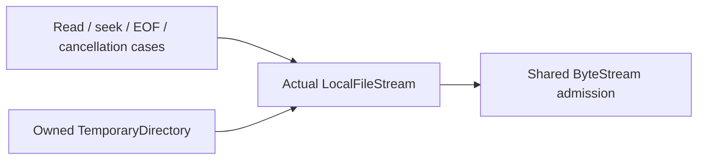

# Local-file stream contracts

`media_local_file_stream_test` links the concrete `wiola_local_file_stream` adapter. Its scoped directory fixture owns each file and outlives the opened stream; sanitizer configurations never share a global test filename.

Cases exercise actual bytes, cursor movement, short/repeated EOF, context rejection without mutation, and missing/nonregular-file failures. Construction requires a successful open. Portable stream admission and signature parsing are tested in their own owners with controlled byte sources, without a decoder dependency here.
