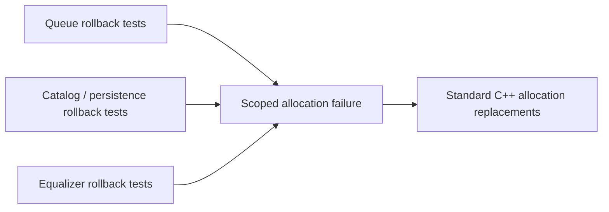

# Shared C++ test support

This directory owns the allocation-failure witness reused by queue, audio, catalog and persistence rollback tests. It is a test dependency, never a production include or link requirement. Controlled decoder/output/tone collaborators remain in `tests/fakes`.

Link `wiola_test_allocation_failure` and include `<allocation_failure.hpp>`. A scope fails an unaligned allocation on its current thread after the requested number of successful allocations, then restores the previous limit on destruction. The default mode keeps failing until the scope ends. `Mode::once` fails one allocation and then permits recovery on that same thread; a controlled worker collaborator can arm it without production hooks. End an owner-thread scope before assertions or other test-library operations. Standard scalar/array and nothrow allocation/deallocation pairs use the same storage; no platform ABI names or linker wrapping are required.

TSan provides strong replacement operators of its own. In that configuration the target supplies `WIOLA_TEST_ALLOCATOR_REPLACEMENT=0` and no replacement object. Guard only allocation-injection cases with this compile definition; keep ordinary behavior and race cases enabled. Debug/ASan and portable cross-compilation retain the allocation cases. This is neither a player allocator abstraction nor a test-selection framework.
