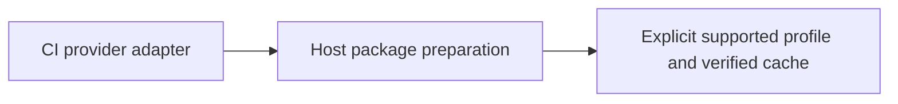

# Remaining build-environment tooling

The remaining [host package adapter](build_environment/README.md) prepares verified Ubuntu packages and explicit build profiles. It will move as one complete component in the next planned build-tool migration.

Maintained developer commands otherwise live under [scripts](../scripts/README.md): [Qt SDKs](../scripts/qt/README.md), [configured builds](../scripts/build/README.md), [test execution](../scripts/testing/README.md) and [quality checks](../scripts/quality/README.md). There is no second implementation of those families here.

