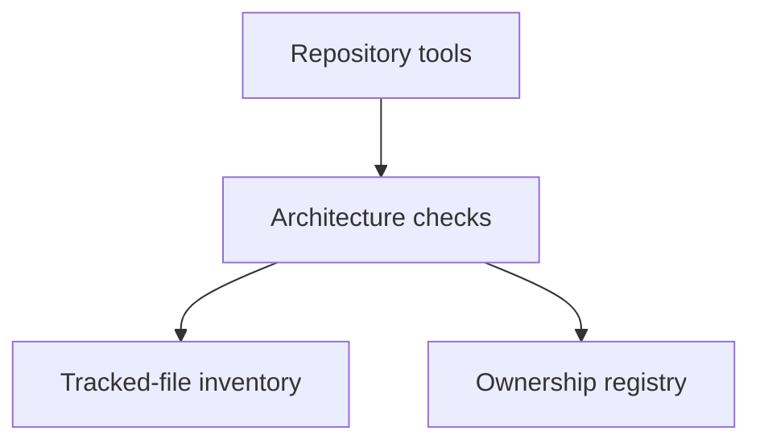

# Repository tools

This tree contains maintained development-tool implementations. It does not participate in the player runtime. Each independent tool abstraction owns its implementation and tests below its own folder.

The current architecture tools inventory tracked-file ownership. Run their checks from the checkout with `python3 -m tools.architecture.commands.check_ownership`; run their tests with `python3 -m unittest discover -s tools -t . -p 'test_*.py'`.

[Architecture](architecture/README.md) describes the actual components. Tool paths and policies are explicit inputs or package resources; there are no assumptions about a developer home directory or build output location.

[Testing tools](testing/README.md) separate semantic test roles from actual runtime coupling and check configured discovery against independently required behaviors.

[Coverage qualification](../scripts/quality/coverage/README.md) separates source applicability, raw process collection and owner measurement. Unmeasured languages and unmapped headers remain visible.

[Qt SDK tooling](../scripts/qt/README.md) lives completely in the canonical scripts family, with source acquisition and both target recipes together.
