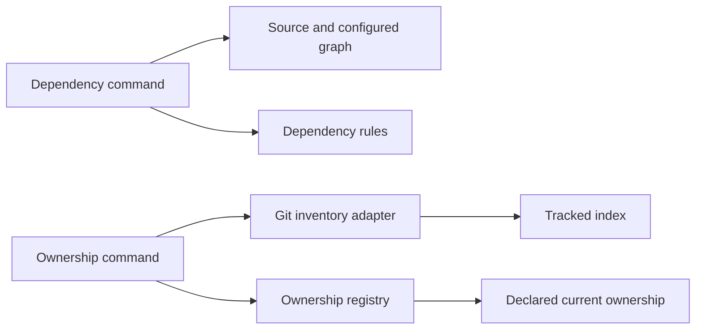

# Architecture tools

These tools describe and check the current repository. They do not make the existing architecture clean simply by assigning names. Ownership declarations are explicit; a move must update the same stable owner rather than silently infer a new owner from its new path.

[Inventory](inventory/README.md) handles Git. [Ownership](ownership/README.md) validates declarations independently of Git. [Configured CMake adapter](../../scripts/build/cmake/README.md) reconciles configured targets without executing a build. [Commands](commands/README.md) assemble the check and return a useful exit status. [Abstraction contracts](contracts/README.md) add explicit cohesion and migration-debt checks. No component imports player or Qt implementation.

[Dependency observation](dependency_graph/README.md) reads explicit includes/imports and configured prerequisites. [Dependency rules](dependency_policy/README.md) reject new upward dependencies, Qt leakage and reviewed private API access; exact legacy exceptions remain visible. Use [the dependency command](commands/check_dependencies/README.md) for diagnostics.
