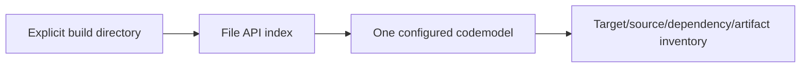

# CMake inventory

`CMakeInventory` reads a configured build's File API codemodel-v2 reply. It reports actual target names, kinds, source ownership, dependency names and artifact paths. It does not configure/build targets or infer a path from a preset name. Declared targets are not evidence that their binaries were built or tested.

Reply references must be local JSON filenames. Unsupported/multiple configurations and inconsistent target identities fail explicitly rather than select an arbitrary variant. Generated sources remain distinct; external dependency sources do not become first-party files. The [contract tests](tests/README.md) exercise a representative reply and rejected variants. Use the command's optional `--build-dir` input to reconcile the configured sources with the ownership registry.
