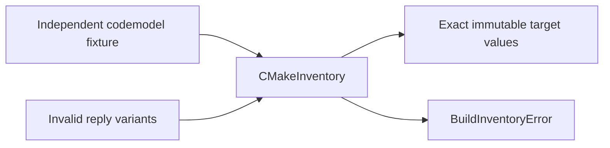

# CMake inventory contracts

Tests construct small independent File API replies in an isolated directory. They assert exact source, generated-source, dependency and artifact resolution, then reject missing replies, escaping references, unknown dependencies and ambiguous configurations.

Run `python3 -m unittest tools.architecture.cmake_inventory.tests.test_inventory`. No player build or SDK installation is required.
