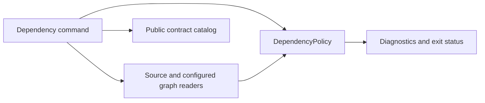

# Dependency check command

Run `python3 -m tools.architecture.commands.check_dependencies` from the checkout. Add `--repository PATH` for a different source root, and `--build-dir PATH` to include an existing matching CMake File API codemodel. The command never configures or builds.

The command assembles the graph, policy and catalog through their public APIs. Source-only runs ignore configured-only debt; configured runs select debt for targets actually present in that configuration; a configured run requires that graph's source root to match. Exit 0 means observed dependencies match the frozen migration debt, 1 reports violations or stale exceptions, and 2 reports invalid inputs. Success does not mean existing exceptions are fixed.
