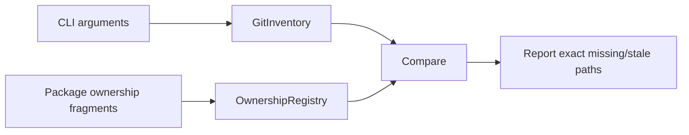

# Check ownership

Run `python3 -m tools.architecture.commands.check_ownership` from the checkout. `--repository` supplies another working-tree location when needed. The command reads its declared policy as a package resource and tracked paths through `GitInventory`.

Exit 0 means inventories match; exit 1 identifies unowned/stale paths; exit 2 reports malformed policy or an execution/input failure. Untracked plans are outside the index and are neither published nor silently accepted as product files. No build or test execution occurs here.

Add `--build-dir <configured-directory>` to reconcile declared first-party CMake target sources with tracked ownership. The build must belong to the supplied repository and already contain a File API codemodel-v2 query reply. This reads metadata only; it never configures or builds the player.
