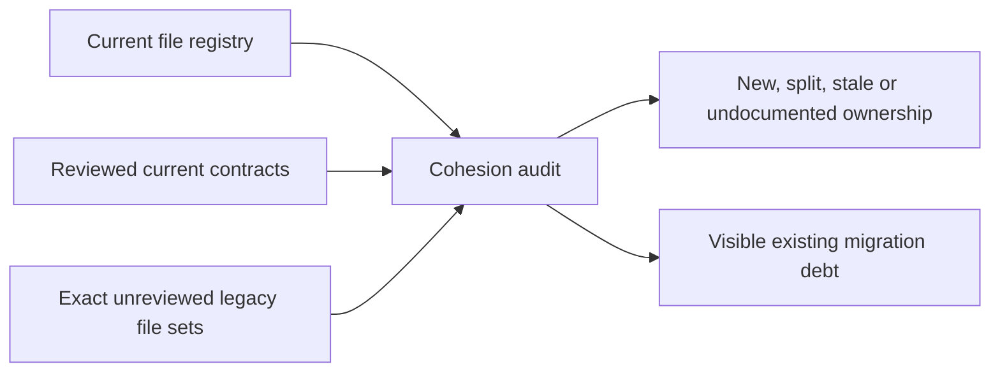

# Abstraction contracts

`ContractCatalog` checks an explicitly reviewed responsibility, invariants, public files and complete owning subtree against the file registry. A grouping folder may contain other owners; an implementation abstraction may not hide another implementation inside its subtree. Its README and public files must belong to the same owner.

`definitions.py` describes reviewed **current** contracts. The data file freezes still-unreviewed legacy owners by exact file-set digest. It is not an exemption for whole directories, a future plan, or approval of the old architecture. New ownership or changed file membership needs a reviewed contract. Remove its legacy record when adding that contract.

These checks prove explicit physical ownership and declared invariants, not that the invariant is semantically correct. Behavioral tests and review remain necessary; adding an unrelated class inside an existing file is not justified by an unchanged file-set digest. The final architecture must retire the legacy debt.

Run `python3 -m unittest tools.architecture.contracts.tests.test_catalog` for the [contracts](tests/README.md).

`load_current_catalog()` in the public `catalog.py` API loads the current definitions and exact legacy inventory. Consumers use the immutable `contracts` tuple instead of importing private definition or data files.
