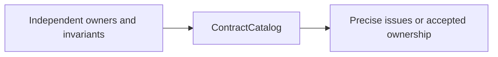

# Contract-catalog tests

Independent small registries demonstrate accepted cohesion, rejected split implementations, undeclared public headers, missing READMEs and unrelated owners inside an abstraction. A grouping-folder case proves legitimate parent/child ownership. Legacy cases prove exact membership and visible debt rather than a wildcard allowance.

The tests do not read the live legacy baseline, so the same data cannot manufacture both actual and expected acceptance.
