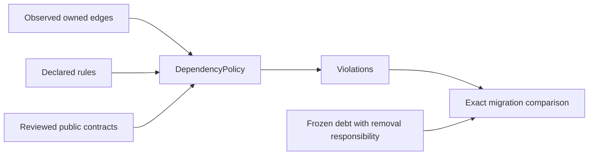

# Dependency rules

`policy.py` checks observed edges against explicit owner-to-module assignments, allowed module directions, Qt capabilities and reviewed public-file contracts. It does not discover files or invoke Git/CMake.

Every new owner needs a module rule. A portable module cannot use Qt; cross-abstraction access must use a reviewed public entrypoint. Existing unreviewed abstractions do not gain an invented private API. Exceptions identify a precise edge, both owners and violated rule. New violations fail, and removed violations fail until their stale exception is deleted. Several violations on one edge remain separate. Configured target diagnostics group identical owner-module directions within the same target pair, rather than reporting a Cartesian list of every source file.

`data/` owns current rules and recorded migration debt. These records expose existing problems; they do not approve the architecture. Tests independently seed reversed dependencies, private access, Qt leakage and stale/multiple violations.
