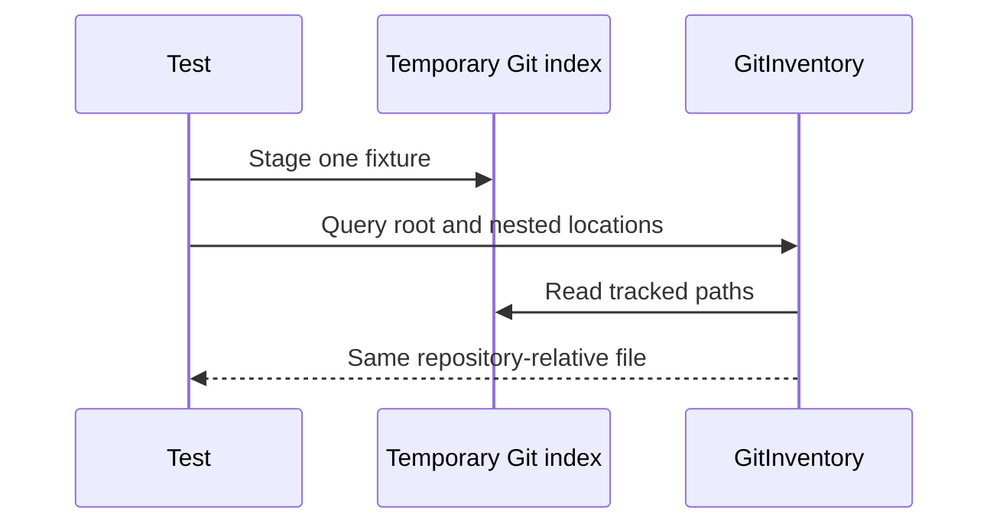

# Git inventory contracts

The tests create an isolated temporary Git repository, stage a Unicode filename, leave a local plan untracked, query from a nested directory, and remove the staged file. They also assert failure outside a repository. No test changes the user's repository.

Run `python3 -m unittest tools.architecture.inventory.tests.test_git_inventory`.

Real temporary Git repositories exercise committed rename continuity, nested callers, Unicode/spaced filenames, changed current policy, unchanged index, genuine new files, invalid paths and invalid revisions.
