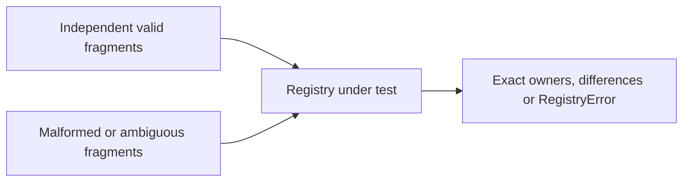

# Ownership registry contracts

These tests use independent small declarations, not the live repository policy, to prove exact resolution, unowned/stale differences, immutable returned values, portable paths and rejection of malformed, ambiguous or unsupported declarations.

Run `python3 -m unittest tools.architecture.ownership.tests.test_registry`. The tests deliberately seed duplicate owners/files/keys and invalid paths rather than merely asserting that today's policy file parses.
