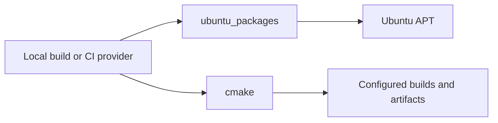

# Build environments

This grouping contains host package and configured build adapters. Each child owns its external-tool interaction, reuse contract and tests. Player targets and GUI choices remain with their callers.

[Ubuntu packages](ubuntu_packages/README.md) prepare installed tools.
[Configured CMake builds](cmake/README.md) build named targets and resolve declared artifacts.
Both adapters are usable by SDK construction, coverage and tests.
