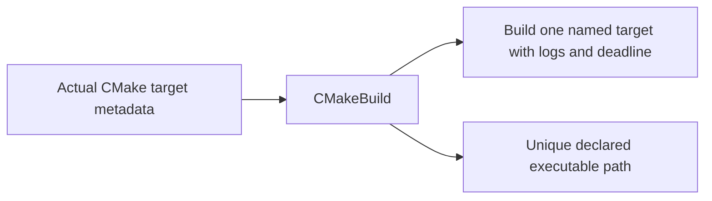

# Configured CMake build adapter

`CMakeBuild` owns target lookup and bounded build invocation. It consumes the public CMake inventory and returns the executable artifact declared by that actual configuration. It does not search `tests/**`, append `.exe`, assume preset directories or know about GoogleTest/Qt.

Unknown targets, non-executable targets, ambiguous artifacts and missing built files fail explicitly. Callers choose the build directory, target and log path. Parallelism comes from an explicit argument, `CMAKE_BUILD_PARALLEL_LEVEL`, or the available CPU affinity/count; a fixed CI worker count is not embedded here. Build failures and timeouts propagate. The command can be supplied when an external tool wrapper is needed. No configure, source mutation or test execution happens implicitly.
