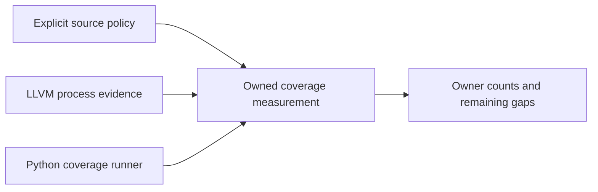

# Coverage qualification

Coverage collection, source applicability and report interpretation have separate owners. C++ and Python metrics remain separate, and uninstrumented languages remain visible.

[Source policy](source_policy/README.md) keeps measurement identity through moves. [Measurement](measurement/README.md) reconciles raw reports and configured sources. [Python runner](python_runner/README.md) collects custom-tool process evidence. The existing LLVM collection entrypoint remains `scripts/coverage.sh`; its remaining build-orchestration responsibilities are still legacy code, not part of these new abstractions.

In an instrumented CMake configuration, `wiola_coverage_ownership` collects Python evidence and reconciles both reports. Its output location comes from this grouping's CMake definition, using the actual binary directory. Run LLVM collection first.

[LLVM reporting](llvm_reporting/README.md) owns external tool invocation and strict diagnostic agreement.
Raw stderr is retained before checking failure or parsing output, so an LLVM abort cannot hide its own diagnosis.
