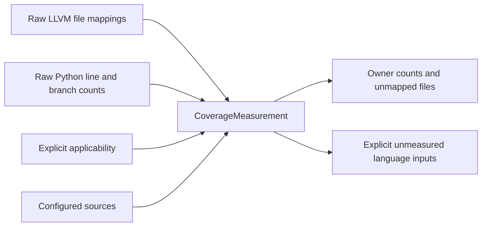

# Coverage normalization by owner

`report.py` exports `CoverageMeasurement`. It interprets LLVM and Coverage.py reports using the source policy and actual CMake inventory. It does not build or execute tests.

A configured production translation unit without a coverage mapping fails. Unmapped headers remain visible because a missing instantiation cannot be assumed covered or nonexecutable. Test mappings inside a production subtree are removed from production totals. Duplicate mappings, unowned first-party inputs, invalid counts and mismatched build roots fail. External files are outside the first-party scope. C++ lines/functions/regions/branches and Python lines/branches use separate denominators; a zero denominator is not a 100% claim.

Run `python3 -m tools.coverage.measurement --cpp-report PATH --python-report PATH --build-dir PATH --output PATH`. [The baseline](baseline/README.md) records a qualified observation, and [tests](tests/README.md) exercise rejected and incomplete evidence. It is not a promise that all owners already meet the final coverage goal.

The legacy LLVM HTML summary still lists every mapped file selected by its collector, including colocated tests. Use this owner-normalized production report for project totals; raw mappings remain evidence rather than a completion badge.
