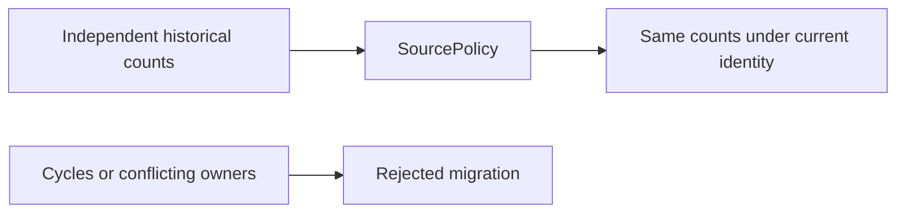

# Source-policy contracts

Independent fixtures cover scope after folder changes, missing/stale ownership, path validation, move chains, cycles, merged identities and owner changes. Historical metric dictionaries must remain unchanged through filename migration.

Run `python3 -m unittest discover -s tools -t . -p 'test_*.py'`. The top-level directory keeps the repository's `tools.coverage` package distinct from the external `coverage` instrumentation library.
