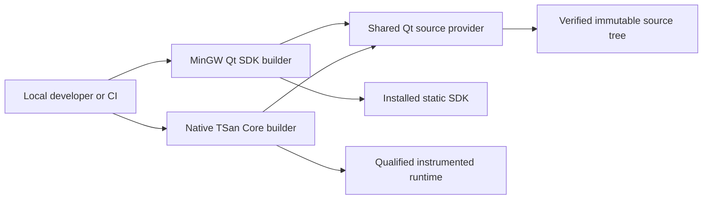

# Development SDK builders

This grouping owns external SDK construction, separate from player runtime code and CI-provider scheduling. Each builder owns its recipe, identity rules, tests and documentation.

[The Qt builder](qt_mingw/README.md) currently supports x86-64 MinGW. No other Windows architecture is built or qualified here.

[The shared source provider](qt_source/README.md) owns every Qt download, release pin, archive verification and extraction.
Both the [static Windows builder](qt_mingw/README.md) and [native TSan Core builder](qt_core_tsan/README.md) consume its public interface.
Build recipes own compiler/ABI configuration and output qualification; they do not fetch or unpack releases.

The Core builder and general [CMake build adapter](../build_environment/cmake/README.md)
consume configured artifact metadata; test-folder conventions are not build APIs.
