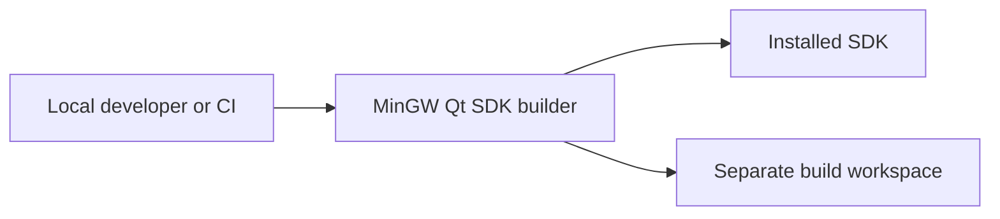

# Development SDK builders

This grouping owns external SDK construction, separate from player runtime code and CI-provider scheduling. Each builder owns its recipe, identity rules, tests and documentation.

[The Qt builder](qt_mingw/README.md) currently supports x86-64 MinGW. No other Windows architecture is built or qualified here.
