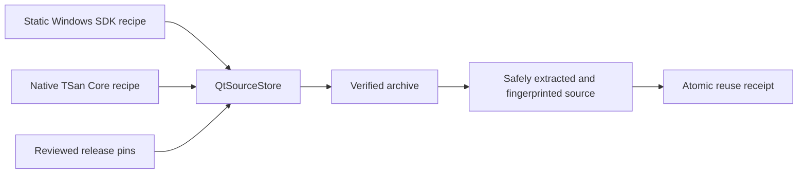

# Qt source provider

This is the single owner of Qt release pins, URLs, downloading, checksum verification, safe extraction and source-cache integrity. The Windows static SDK and native TSan Core builder consume this provider; neither implements another downloader.

`QtSourcePin.resolve(version)` selects a reviewed release from `pins.json`. Add a new verified release there once for both builders. `QtSourceStore.materialize(pin, workspace)` returns the source directory. `python3 -m tools.sdk.qt_source VERSION WORKSPACE` exposes that same operation to shell/CMake callers; `--identity` prints its source/recipe identity without downloading. The provider knows no compiler, Qt build flags, target platform or CI provider.

Downloads use private temporary files, bounded failure/inactivity retries and SHA-256 verification before admission. Extraction uses Python's data filter in a staging directory. A complete tree fingerprint covers file bytes, executable bits, directory entries and symlink targets. Cache receipts are written atomically. Edited existing source trees are rejected and preserved; identical legacy trees can be adopted after comparing them with a verified extraction. Concurrent publishers use private staging and admit only identical final trees. Partial downloads and failed verification cannot become valid cache entries.

Builders accept `WIOLA_QT_SOURCE_CACHE` to share an explicit source workspace. There is no built-in home/system directory. A restored installed SDK may skip source materialization entirely after its builder's output qualification succeeds. This provider does not claim that a release pin proves every host Qt ABI configuration; each build recipe owns that qualification.
