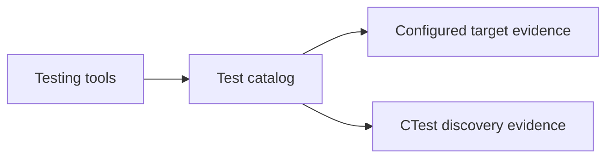

# Testing tools

This grouping owns test-policy tooling, separate from the player and test fixtures. [The catalog](catalog/README.md) records test purpose, actual toolkit coupling and independently required behavior witnesses.

A new independent tool owns its complete implementation and tests in its own subtree. Grouping files contain no test execution policy.
