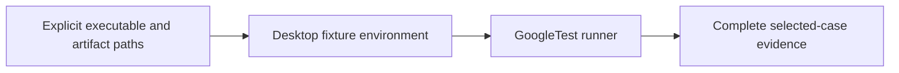

# Packaged desktop checks

This owner composes the reusable [GoogleTest protocol](../gtest/README.md) with Wiola desktop fixture variables. `DesktopEnvironment` copies the inherited environment, resolves the caller's media/artifact locations and optionally applies an explicit Qt platform choice. It has no operating-system or build-directory guesses.

Run `python3 -m tools.testing.desktop_checks --help`. The existing `scripts/run-desktop-journeys.py` remains a compatibility launcher. Existing binary/artifact/revision/filter/minimum/media arguments remain accepted; `--timeout`, `--qt-platform` and repeated `--require-case` make execution bounds, GUI adapter selection and semantic requirements explicit. The project composition retains the desktop suite's default filter; the shared runner has no project case names.

The caller owns platform selection, including `QT_QPA_PLATFORM=windows` for a native Windows check and `offscreen` when deliberately running a Qt check without a display. An inherited choice is preserved. Replacing the GUI affects this fixture adapter and the desktop contracts rather than the reusable process/report protocol. Every selected case must actually finish, even when the caller requests a smaller minimum; minimum counts cannot hide skipped or missing cases.
