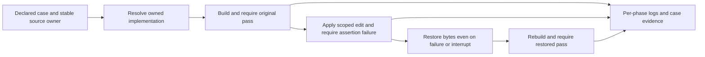

# Regression mutation qualification

This owner composes [scoped source edits](../source_mutation/README.md), the configured [CMake build adapter](../../../scripts/build/cmake/README.md), and the [GoogleTest protocol](../gtest/README.md). `MutationCatalog` validates regression recipes; `MutationVerifier` controls baseline, mutant and restored qualification. The narrow build port permits another build adapter without changing source restoration or assertion evidence.

`cases.json` contains the existing six regression edits and their test selections. Recipes identify a stable source owner rather than a current `src/gui/...` or `src/desktop/...` path. The ownership registry resolves its unique implementation, so a correctly registered source relocation does not require editing the mutation engine or recipe. Ambiguous owners or drifted anchors fail explicitly. The recipe's exact edit is intentionally coupled to the behavior under test; it is not a build-path convention embedded in the runner.

Run `python3 -m tools.testing.mutation_checks --help`. The existing `scripts/check-gui-mutations.py` stays a compatibility launcher. Build directory, artifacts, catalog, selected identities, workers and deadlines are caller inputs. Executables come from actual configured artifacts, without `tests/**` searches or `.exe` guesses. GUI/backend environment is inherited rather than selected by the engine.

Native GUI-enabled builds expose `wiola_check_mutations`: invoke it through the desired CMake build preset and CMake supplies its actual binary directory. The artifact directory comes from `--artifacts`, `WIOLA_MUTATION_ARTIFACTS`, or that build's `Testing/Mutations` directory. CI uses this target and chooses an explicit runner-temporary artifact directory; it does not duplicate the preset's physical build path or a fixed worker count in the mutation command.

Qualification requires a clean tracked worktree and a passing baseline. Surviving mutations, crashes, empty selections, skipped cases and invalid reports fail. The original is rebuilt and tested after mutant build/process failures as well as successful assertion detection. Another writer's edit is never overwritten or represented as a restored build. SIGTERM becomes a scoped interruption and its prior handler is restored. Per-case evidence is written even when qualification fails; the aggregate report contains only fully qualified cases. A non-catchable termination cannot promise cleanup; retained source/receipt comparison determines recovery.
