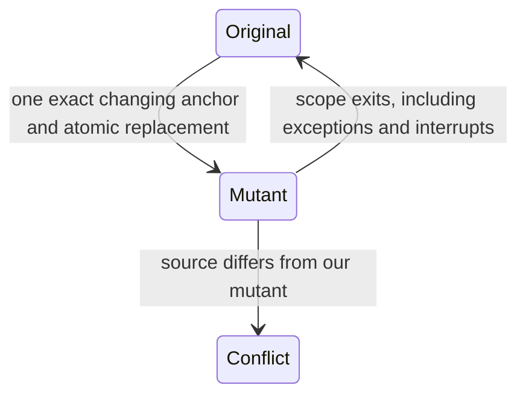

# Scoped source mutation

`SourceMutation` owns one exact temporary byte edit and restoration. It has no build, Git, GUI or test-framework dependency.

Constructing the edit snapshots the original bytes and mode and validates that the nonempty anchor occurs exactly once. Entering the scope verifies that the source still matches the snapshot. Writes are prepared in the source directory and atomically replace the file; incomplete temporary writes cannot truncate the original. Exiting restores exact bytes and permissions, including on `KeyboardInterrupt`. Fresh modification times deliberately force build systems to rebuild the restored source.

If another writer changes or removes the source during the scope, restoration refuses to overwrite that writer's data. This comparison detects interference; it is not a filesystem-wide lock against unrelated editors. Callers must stop qualification on conflict and cannot claim a restored build. Original/mutant digests and the `restored` query support evidence without duplicating edit logic.
